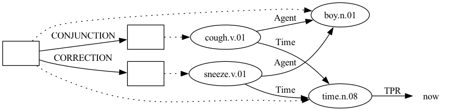
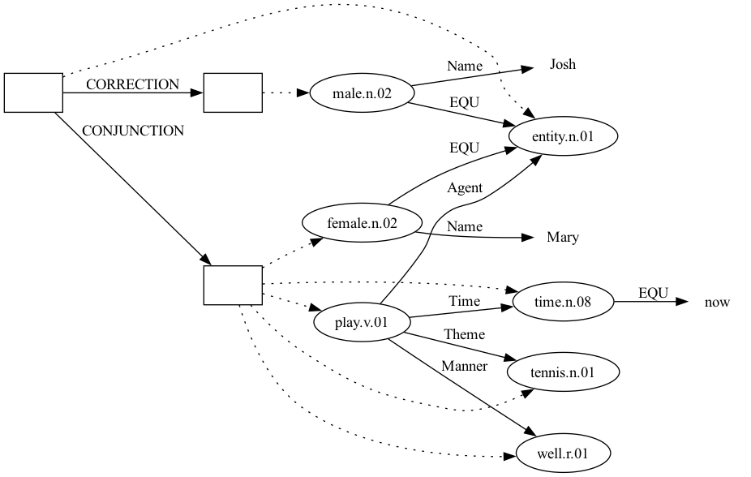
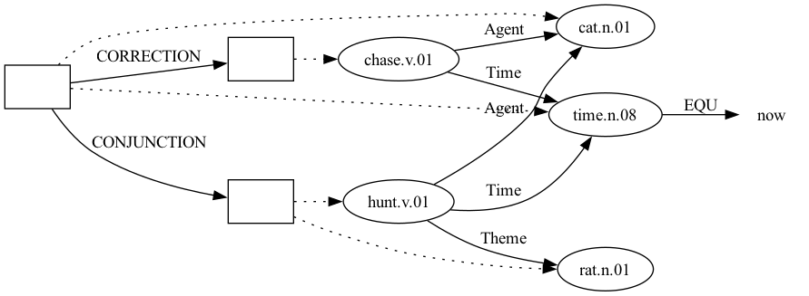
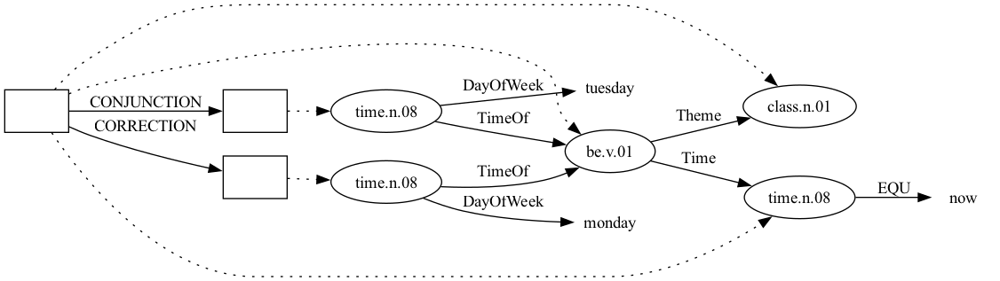
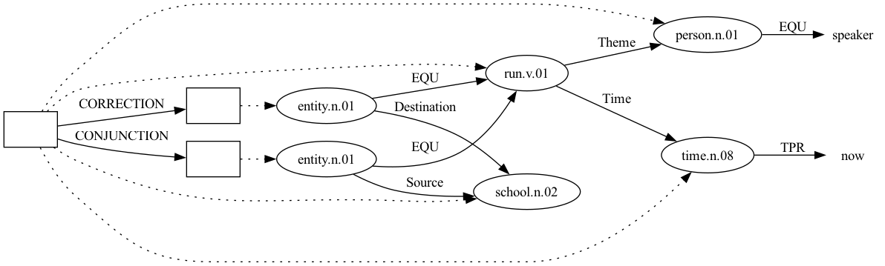
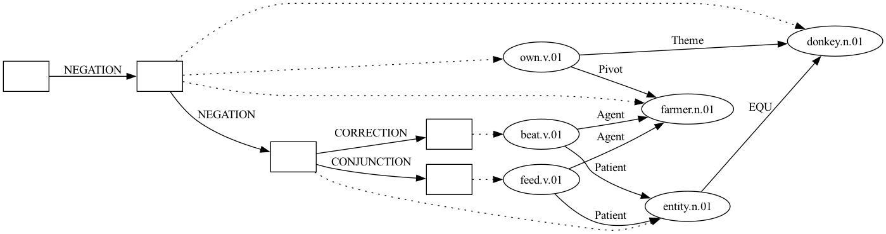
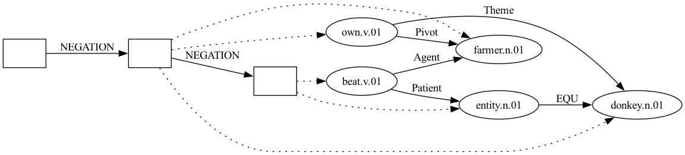
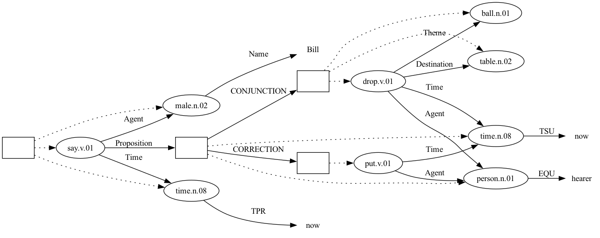
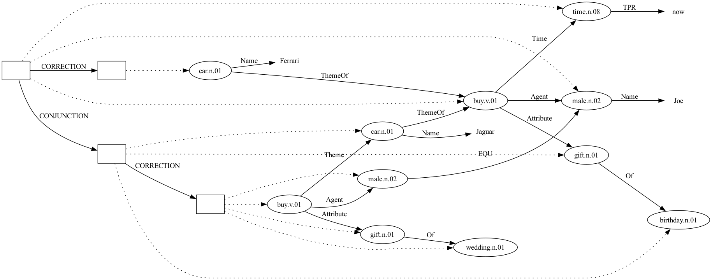

# Extension goals and design principles {#sec-goals}

This project extends SBN to represent replacement self-repair while preserving as much of its existing design as possible. The representation retains the reparandum, marks its contribution as withdrawn, and incorporates the repair into the speaker's accepted content.

The extension adds `CORRECTION` and pairs it with the existing `CONJUNCTION` separator. It uses SBN concepts, roles, context boxes and relative indices to encode the repair. The main design preferences are to follow surface order, retain shared material, and respect scope and accessibility when connecting arguments across contexts.

This document defines the repair notation used in the project. The [SBN Annotation Working Manual](https://github.com/hongxuzhou/lct_master_project/blob/main/SBN_Annotation_Working_Manual.md) supplies the underlying SBN conventions. Parser requirements are collected in [Appendix A](#sec-tools).

# Representation mechanism {#sec-mechanism}

## Correction and commitment

Van Leusen (2004) analyses correction through incompatibility in context. The antecedent and corrective claim compete as descriptions of a common local setting. Pragmatic strengthening and accommodation can make them incompatible even when their literal contents are compatible in other settings.

A correction changes which contribution is accepted while retaining a record of the earlier material. Van Leusen distinguishes the accumulation of discourse descriptions from changes to discourse meaning: the description can grow as an earlier entailment is withdrawn. This distinction motivates keeping the reparandum in the representation after repair.

The semantic basis comes from the SDRT relation *Correction*. Lascarides & Asher (2009) classify it as divergent and subordinating, with the following interpretation:

$$
(w, f) \llbracket \mathit{Correction}(\pi_1, \pi_2) \rrbracket_m (w', g)
\quad\text{iff}\quad
(w, f) \llbracket \neg K_{\pi_1} \land K_{\pi_2} \land \varphi_{\mathit{Correction}(\pi_1,\pi_2)} \rrbracket_m (w', g)
$$

The first argument is denied and the second is accepted. The condition $\varphi_{\mathit{Correction}(\pi_1,\pi_2)}$ supplies the constraints on the corrective relation. The SBN extension implements self-repair through the paired construction below.

## Abstract description

The contribution of a replacement self-repair is represented schematically as:

:::{.text-center}
$$
K = K_{\pi_{\text{pre}}} \land \neg K_{\pi_m} \land \bigl(K_{\pi_n} \land K_{\pi_{\text{post}}}\bigr) \land \varphi_{\mathit{Corr}(\pi_m,\pi_n)}
$$
:::

| Component | Contribution |
|---|---|
| $K_{\pi_{\text{pre}}}$ | Material before the reparandum |
| $K_{\pi_m}$ | Reparandum |
| $K_{\pi_n}$ | Repair |
| $K_{\pi_{\text{post}}}$ | Continuation after the repair |
| $\varphi_{\mathit{Corr}(\pi_m,\pi_n)}$ | Constraints on the correction, including incompatibility in context |

These components can depend on shared referents and background. The formula describes the repair within its enclosing context. A repair inside negation, for example, is interpreted within that negated context.

## The paired box construction {#sec-pair}

`CORRECTION` opens a box containing the reparandum. The paired `CONJUNCTION` returns the repair and subsequent content to the context that was active before `CORRECTION`. Both separators point to that context, giving the two boxes a common parent in the parsed graph.

For a local pair, `CORRECTION <1` targets the preceding box and `CONJUNCTION <2` targets the same box from two box positions later. The target can be the root or an embedded context.

`CONJUNCTION` retains its SBN merge function (Bos 2021, 2023). The parser records a box for its material; semantically, that material is merged into the target context. Material following `CONJUNCTION` remains in its parsed box until the next separator. This includes predicates and arguments beyond the repair itself.

## Basic example

> The boy sneezed, I mean, coughed.

```sbn
boy.n.01                       % The boy
time.n.08 TPR now
    CORRECTION <1
sneeze.v.01 Agent -2 Time -1   % sneezed,
    CONJUNCTION <2             % I mean,
cough.v.01 Agent -3 Time -2    % coughed
```



The boy and past-time referent are shared. The sneezing event is represented in the `CORRECTION` box; the coughing event is supplied by the repair and merged into the enclosing context. Both events connect backwards to the shared subject and time.

# Annotation rules and construction methods {#sec-rules}

## Relative indices

Concept indices count positions in the complete concept sequence. `Role -n` counts backwards and `Role +n` forwards. Separators leave this count unchanged, so concepts in other boxes still occupy positions in the sequence.

Box indices use angle brackets. `CORRECTION <1` and `CONJUNCTION <2` count boxes; their numbers are independent of the concept count. `Proposition >1` also points to a box. The embedded-clause example in [Section 4](#sec-embedded) shows its use with `CONTINUATION <0`.

## Argument accessibility {#sec-access}

Bos (2021) states the SBN accessibility rule for negation:

> Accessibility: (a) neither positive nor negative indices can enter negated context, and (b) only negative indices in negated contexts can refer to discourse referents outside the negation.

The denial in *Correction* motivates the following constraints on ordinary argument links in the repair extension:

- An earlier concept cannot use a forward thematic-role link into the reparandum box.
- A concept in the reparandum box can refer backwards to an accessible ancestor context.
- A concept in the reparandum box cannot take an argument from the later sibling `CONJUNCTION` box.

A negative index must still satisfy accessibility: an earlier sibling box is not an ancestor. The paired `CONJUNCTION` merges into its target and permits the corresponding argument connections. [Subsequent reference](#sec-reference) has a separate, restricted permission to refer to retained reparandum material.

## Reparandum content and shared arguments

The reparandum box contains the contribution of the abandoned span. Arguments that have not yet been uttered under that span are left unwritten. In *The cat chases, actually, hunts the rat*, the abandoned `chase` predicate has no `Theme`; the rat is introduced with the repair continuation.

Shared referents can remain in the enclosing context. The repair and reparandum then connect to them through the permitted links. The following methods handle cases where a direct link would cross the reparandum boundary.

## Constructing the argument links {#sec-methods}

| Situation | Method | Example |
|---|---|---|
| An argument has not been uttered when the span is abandoned | Leave its role unwritten | Verb repair |
| A shared predicate precedes a repaired argument | Put the inverted role on each candidate argument | Object repair with `ThemeOf` |
| A role itself is repaired | Attach each competing role to a dummy concept linked to the shared host by `EQU` | Preposition repair |
| An argument must precede the repair boxes to remain accessible | Move the argument concept before the pair | The pronoun in the conditional example |

Role inversion expresses the same relation from the other endpoint: `Theme(x,y)` corresponds to `ThemeOf(y,x)`. In object repair, it places the withdrawn role condition inside the reparandum box while keeping its predicate in the enclosing context. Inversion alone cannot make a sibling target accessible.

A dummy linked by `EQU` lets a condition be represented in the box where it belongs. For role repair, it carries the competing role. The subject example uses an outer dummy to anchor a shared argument position. The identity conditions remain within their respective contexts.

Movement changes concept order, so it is reserved for connections that the other methods cannot represent. The conditional example moves the pronoun referent before the repair pair. Parser limits on index magnitude are listed in [Appendix A](#sec-tools).

## Interregna

Interregna such as *I mean*, *no* and *actually* are recorded in the `%` comment on `CONJUNCTION`. They receive no separate semantic content in this notation. The comment position preserves their place between reparandum and repair.

# Construction examples {#sec-examples}

## Repairs within a clause

### Subject repair

> Josh, no, Mary plays tennis well.

```sbn
entity.n.01
    CORRECTION <1
male.n.02 Name "Josh" EQU -1                  % Josh,
    CONJUNCTION <2                            % no,
female.n.02 Name "Mary" EQU -2                % Mary
play.v.01 Agent -3 Time +1 Theme +2 Manner +3 % plays
time.n.08 EQU now
tennis.n.01                                   % tennis
well.r.01                                     % well
```



The outer `entity.n.01` anchors the Agent position of `play.v.01`. Josh and Mary each have an `EQU` condition linking them to that position. Josh's condition is withdrawn inside `CORRECTION`; Mary's condition is supplied by the repair. The predicate, time, object and manner adverb follow in the `CONJUNCTION` box and merge into the enclosing context.

### Object repair

> I ordered a banana bread, I mean, a cherry pie.

```sbn
person.n.01 EQU speaker              % I
time.n.08 TPR now
order.v.01 Agent -2 Time -1          % ordered
    CORRECTION <1
banana_bread.n.01 ThemeOf -1         % a banana bread,
    CONJUNCTION <2                   % I mean,
cherry_pie.n.01 ThemeOf -2           % a cherry pie
```


The ordering event precedes both candidate objects. Each object uses `ThemeOf` to point backwards to it. This places the withdrawn Theme condition with banana bread and the accepted Theme condition with cherry pie.

### Verb repair

> The cat chases, actually, hunts the rat.

```sbn
cat.n.01                            % The cat
time.n.08 EQU now
    CORRECTION <1
chase.v.01 Agent -2 Time -1         % chases,
    CONJUNCTION <2                  % actually,
hunt.v.01 Agent -3 Theme +1 Time -2 % hunts
rat.n.01                            % the rat
```



Both predicates share the cat and the present-time referent. Only `hunt.v.01` takes the rat as its Theme, because that object is uttered after the repair. PMB examples of predicates with unexpressed arguments are collected in [Appendix B](#sec-pmb).

### Tense replacement

> She will go to, well, went to the church.

```sbn
female.n.02                                % She
    CORRECTION <1
time.n.08 TSU now                          % [will]
go.v.01 Theme -2 Time -1                   % go to,
    CONJUNCTION <2                         % well,
time.n.08 TPR now                          % [went]
go.v.01 Theme -4 Time -1 Destination +1    % went to
church.n.02                                % the church
```


The two alternatives contain an event and a time referent. The future time condition is withdrawn and the past time condition is accepted. The church appears after the repair, so only the second event has a Destination.

Here the tense contrast is expressed through `time.n.08`, temporal operators and the `Time` role. The existing context structure can therefore be retained while the event-and-time contributions are replaced.

### Time-value replacement

> The class is on Monday, no, on Tuesday.

```sbn
class.n.01                                % The class
time.n.08 EQU now
be.v.01 Theme -2 Time -1                  % is on
    CORRECTION <1
time.n.08 DayOfWeek monday TimeOf -1      % Monday,
    CONJUNCTION <2                        % no,
time.n.08 DayOfWeek tuesday TimeOf -2     % on Tuesday
```



Each alternative supplies a weekday value on a time concept and links it to the shared predicate through `TimeOf`. The values are lower-case constants, `monday` and `tuesday`.

### Semantic-role replacement

> I ran to, I mean, from the school.

```sbn
person.n.01 EQU speaker              % I
time.n.08 TPR now
run.v.01 Theme -2 Time -1            % ran
school.n.02                          % the school
    CORRECTION <1
entity.n.01 EQU -2 Destination -1    % to,
    CONJUNCTION <2                   % I mean,
entity.n.01 EQU -3 Source -2         % from
```



The repaired preposition contributes an event-participant relation. A dummy `entity.n.01` in each box is linked to the running event by `EQU`. The first carries `Destination` and the second `Source`, so the competing role conditions receive their respective withdrawal and acceptance status.

The school is placed before the pair so both alternatives can reach it. The use of a dummy follows the SBN device for assigning conditions to a shared referent across contexts (Bos 2021). It uses the legal concept `entity.n.01`.

## Repairs extending across a phrase

> Josh drove, no, Marsha drove the old car to the church.

```sbn
entity.n.01
    CORRECTION <1
male.n.02 Name "Josh" EQU -1                         % Josh
time.n.08 TPR now
drive.v.03 Agent -2 Time -1                          % drove,
    CONJUNCTION <2                                   % no,
female.n.02 Name "Marsha" EQU -4                     % Marsha
time.n.08 TPR now
drive.v.03 Agent -2 Time -1 Theme +2 Destination +3  % drove
old.a.02 AttributeOf +1                              % the old
car.n.01                                             % car
church.n.02                                          % to the church
```


This forwarding repair replaces a larger span containing the subject and predicate. Each alternative has its own driving event and past-time referent. The car and church are supplied after the repair, so only the accepted driving event has Theme and Destination links. The adjective attaches to the car through `AttributeOf`.

## Repairs in embedded contexts {#sec-embedded}

### Negation

> I didn't order a banana bread, I mean, a cherry pie.

```sbn
person.n.01 EQU speaker              % I
time.n.08 TPR now
    NEGATION <1                      % didn't
order.v.01 Agent -2 Time -1          % order
    CORRECTION <1
banana_bread.n.01 ThemeOf -1         % a banana bread,
    CONJUNCTION <2                   % I mean,
cherry_pie.n.01 ThemeOf -2           % a cherry pie
```


The ordering event is inside the negated context. Both repair boxes target that context:

```text
BOX0 → NEGATION → BOX1
BOX1 → CORRECTION → BOX2
BOX1 → CONJUNCTION → BOX3
```

`CONJUNCTION <2` merges the cherry-pie alternative into BOX1, preserving the scope of *didn't* over the accepted ordering claim.

### Conditional

> If a farmer owns a donkey, he beats, I mean, feeds it.

```sbn
    NEGATION <1                          % If
farmer.n.01                              % a farmer
own.v.01 Pivot -1 Theme +1               % owns a
donkey.n.01                              % donkey,
    NEGATION <1
entity.n.01 EQU -1                       % it
    CORRECTION <1
beat.v.01 Agent -4 Patient -1            % he beats,
    CONJUNCTION <2                       % I mean,
feed.v.01 Agent -5 Patient -2            % he feeds it
```



SBN represents the conditional through two nested negations. The first opens BOX1 for the restrictor; the second opens BOX2 inside it for the consequent. The repair pair belongs to BOX2, and both predicates reach the farmer and donkey through their accessible contexts.

The second `NEGATION <1` is essential to this nesting. A connector of `<2` would attach the second negation to the root, producing two separate negated contexts.

For comparison, Bos's (2021) example *Every farmer who owns a donkey beats it* has the following sequence:

```sbn
NEGATION -1                     % Every
farmer.n.01                     % farmer
own.v.01 Pivot -1  Theme +1     % who owns
donkey.n.01                     % a donkey
NEGATION -1
beat.v.01 Agent -3  Patient +1  % beats
entity.n.01 EQU -2              % it
```



The baseline places the pronoun referent after the predicate. The repair example moves it before `CORRECTION`, allowing both competing predicates to reach it without a forward link from the reparandum into the repair continuation.

### Embedded proposition and retracting repair

> Bill said you will put, I mean, you will drop the ball on the table. (Husband 2015)

```sbn
male.n.02 Name "Bill"                              % Bill
say.v.01 Proposition >1 Agent -1 Time +1           % said
time.n.08 TPR now
    CONTINUATION <0
person.n.01 EQU hearer                             % you
time.n.08 TSU now                                  % will
    CORRECTION <1
put.v.01 Agent -2 Time -1                          % put,
    CONJUNCTION <2                                 % I mean,
drop.v.01 Agent -3 Time -2 Theme +1 Destination +2 % you will drop
ball.n.01                                          % the ball
table.n.02                                         % on the table
```



`Proposition >1` points to the embedded clause introduced by `CONTINUATION <0`. The repair pair is constructed inside that clause. The shared hearer and future-time referents precede the pair.

The abandoned `put` predicate has no Theme or Destination: neither argument has been uttered at that point. The accepted `drop` predicate takes the later ball and table within its own `CONJUNCTION` box.

# Subsequent reference and cross-turn correction {#sec-discourse}

## Reference to the reparandum {#sec-reference}

A reparandum remains represented after its original contribution is withdrawn. A later expression can refer to an associated referent when the discourse supports that interpretation. The reference targets the retained referent directly; it leaves the original assertion withdrawn.

In this serialisation, the later reference uses a backward index. Its interpretation also depends on the intended referent and the relation expressed by the continuation. Enclosing scope constraints still apply. Structural retention supplies a possible target for reference without automatically asserting its existence in the enclosing context.

Keshet & Abney (2024) show why antecedent descriptions and the conditions on subsequent reference matter in non-veridical contexts. Their distinction between particular-individual and kind reference also informs the interpretation of repair continuations.

## Group construction

`ANA` expresses identity reference. When a later plural expression constructs a group from separately introduced referents, the group has a `Sub` link to each member.[^later-reference-sub] A later mention of that established group can use `ANA`.

Explicit numerical expressions such as *both* or *two* receive a `Quantity` condition. A plain *they* does not acquire an explicit quantity solely from the number of antecedents. Whether the members are particular objects or kinds is determined from the discourse; an evaluative predicate alone does not settle the reading.

> A: My favourite dessert is banana bread, actually, cherry pie.
>
> B: They are both good desserts.

```sbn
%%% Utterance 1
person.n.01 EQU speaker                    % A: My
favorite.a.02 Experiencer -1 Stimulus +1   % favourite
dessert.n.01                               % dessert
time.n.08 EQU now
be.v.02 Theme -2 Time -1                   % is
    CORRECTION <1
banana_bread.n.01 Co-ThemeOf -1            % banana bread, (reparandum)
    CONJUNCTION <2                         % actually,
cherry_pie.n.01 Co-ThemeOf -2              % cherry pie (repair)
%%% Utterance 2
    CONTINUATION <1
entity.n.01 Sub -2 Sub -1 Quantity 2        % B: They ... both — groups reparandum and repair
time.n.08 EQU now                          % are
be.v.02 Theme -2 Time -1 Co-Theme +2
good.a.01 AttributeOf +1                   % good
dessert.n.01                               % desserts
```

The schematic below shows the member links. The SBN above also represents the predicates and clause structure.

```{mermaid}
flowchart LR
    subgraph withdrawn[CORRECTION: retained reparandum]
        bread[banana_bread.n.01]
    end
    subgraph accepted[CONJUNCTION: accepted repair]
        pie[cherry_pie.n.01]
    end
    group["entity.n.01: later plural referent, Quantity 2"]
    group -->|Sub| bread
    group -->|Sub| pie
```

`Sub -2` reaches banana bread and `Sub -1` reaches cherry pie. `Quantity 2` records *both*. The continuation evaluates the two members without making banana bread the speaker's favourite dessert again. The example permits a kind reading.

In the first clause, both alternatives connect to the copula through `Co-ThemeOf`. In the second, `Co-Theme` connects the plural referent to the predicate nominal *good desserts*.

[^later-reference-sub]: Earlier versions used two `ANA` links for this example. Multiple `Sub` links bring group construction into line with existing SBN practice. The accessibility convention is unchanged by this revision.

## Cross-turn correction

The same `CORRECTION` token is used for correction across turns. The configurations differ as follows:

| | Replacement self-repair | Cross-turn correction |
|---|---|---|
| Construction | `CORRECTION` followed by a paired `CONJUNCTION`, both targeting the enclosing context | `CORRECTION` connects the disputed context to the correcting contribution |
| Interpretation | The pair isolates the reparandum and incorporates the repair | The earlier claim is denied and the correcting claim is accepted |

In the parsed graph, separator edges run from their target box to the new box. In cross-turn correction, these endpoints correspond to the first and second arguments of the SDRT relation. In self-repair, the new `CORRECTION` box contains the reparandum; the two separator edges together encode the correction.

> A: Joe bought a Ferrari, I mean, a Jaguar, as a birthday gift.
>
> B: No, he bought it as a wedding gift.

```sbn
%%% A's utterance
male.n.02 Name "Joe"                     % Joe
time.n.08 TPR now
buy.v.01 Agent -2 Time -1 Attribute +3   % bought
    CORRECTION <1                        % [intra-turn: has a sibling CONJUNCTION]
car.n.01 Name "Ferrari" ThemeOf -1       % a Ferrari  (reparandum)
    CONJUNCTION <2                       % I mean,
car.n.01 Name "Jaguar" ThemeOf -2        % a Jaguar   (merged back into BOX0)
gift.n.01 Of +1                          % as a
birthday.n.01                            % birthday gift
%%% B's utterance
    CORRECTION <1                        % No, [cross-turn: no sibling CONJUNCTION]
male.n.02 EQU -7                         % he
buy.v.01 Agent -1 Theme -4 Attribute +1  % bought it
gift.n.01 Of +1                          % as a
wedding.n.01                             % wedding gift
```



A's self-repair creates sibling boxes for Ferrari and Jaguar. B's `CORRECTION <1` then targets BOX2, A's `CONJUNCTION` box, and opens BOX3 for the correcting contribution. BOX2 contains the Jaguar and birthday-gift material; B refers to that car and restates the purchase with the wedding-gift description. The correcting utterance and its context identify the disputed purpose.

The first `CORRECTION` has a following paired `CONJUNCTION`; B's correction has no such partner. An earlier `CONJUNCTION` elsewhere in the sequence does not form a pair with a later correction. The current scorer's same-parent check and its scope are documented in [Appendix A](#sec-tools).

# Coverage and limitations {#sec-limits}

The examples cover replacements of concepts, values on concepts, semantic roles and larger spans. They also show repairs inside negation, conditionals and embedded propositions, together with subsequent reference and a cross-turn correction.

## Replacing scope or discourse structure

Under the SBN rules and local repair construction adopted here, the extension does not support repairs that replace a separator's scope-forming or discourse-organising contribution.

The abstract description separates the withdrawn contribution from the accepted contribution and its continuation. Concept and value replacements can place their conditions in the two repair boxes while retaining the existing context structure. A value contributes through a condition on its host concept.

A separator determines how contexts are connected or how material is scoped. Replacing that contribution can require changes to the structure governing shared material and the continuation. The current pair supplies no operation for making those changes. The restriction applies to replacing the separator's contribution; repairs within an existing embedded context are shown in [Section 4](#sec-embedded).

### Quantifier replacement

> Every, no, some dishes are tasty.

Universal quantification uses nested `NEGATION` contexts, while existential quantification does not require the same structure. The change affects the scope of the shared noun and predicate. The current local pair does not rebuild these alternative scope structures around the shared continuation.

### Rhetorical-relation replacement

> I helped my mum when, even though I was busy.

On the intended reading, the repair changes the relation between the clauses while retaining their content. If that relation is encoded by a separator, it connects contexts. The local repair pair does not replace that connection with an alternative over the shared clauses.

### Modal replacement

> I think you would, well, should work harder.

Where the intended readings use `NECESSITY`, `POSSIBILITY` or another separator, replacing the modal changes the operator governing the shared clause. The current pair does not replace that operator while preserving the required scope. The restriction depends on the SBN encoding of the reading.

## Delayed repair

> I bought three apples from Lidl yesterday, actually, four.

Here *four* replaces *three* after unrepaired material has intervened. The delay falls outside the local pre–reparandum–repair–post pattern.

`CORRECTION` at *actually* cannot retrospectively isolate the earlier quantity condition. Placing it before that condition would also withdraw *from Lidl yesterday* if the material stays in surface order until the repair. An encoding must therefore separate the intervening content from the earlier contribution being withdrawn.

The current movement method relocates argument concepts to satisfy access constraints. It does not define how to relocate an intervening span for delayed repair. This remains a limitation of the present serialisation and alignment conventions.

# Appendix A. Tool compatibility {#sec-tools .unnumbered}

## Comments

The parser recognises an inline comment at ` % `, with whitespace on both sides. Use `%%%` for standalone comment lines. An empty trailing `%` can be treated as a token when its following whitespace is removed, so empty comments should be omitted from parser input.

## Index magnitude

The current `SBNSpec.INDEX_PATTERN` reads one digit. Indices with magnitude 10 or greater can be truncated during parsing. The validator checks this limit alongside unresolved indices, graph acyclicity and lost edges. Movement can increase index magnitudes, so moved examples need the same checks.

## Inverted roles and scoring

The parser must accept an inverted role in `ROLES` and register it in `INVERTIBLE_ROLES`. Penman conversion then writes the corresponding `-of` edge for scoring. The project's current parser registers inverses automatically for eligible roles, including the thematic roles used in these examples. This extends the parser's role coverage using the SBN inversion mechanism.

Scoring also requires inverse-edge normalisation. See the [evaluation documentation](https://github.com/hongxuzhou/lct_master_project/blob/main/evaluation/README.md) for the configured standardiser and repair metrics.

## Repair-pair detection

The current scorer detects repairs through `CORRECTION` and `CONJUNCTION` edges with the same parent. In a mixed discourse, a later cross-turn correction can share that parent with an earlier `CONJUNCTION`; the implementation can then pair them incorrectly. More general pair detection needs to enforce the order of the two separators and resolve their pairing.

## Example conventions

The existing example sequences retain their illustrative sense numbers. A complete WordNet sense review is still pending. The July example audit is retained in the [review record](repair_sbn_notation_review.md).

# Appendix B. PMB comparisons {#sec-pmb .unnumbered}

The following gold examples support the construction choices discussed in the text. Their document identifiers allow comparison with the local PMB 5.1.0 data.

| Feature | PMB example | Relevant annotation |
|---|---|---|
| Unexpressed argument | `p62/d1986`, *I also did not call.* | `call.v.03` has Agent and Time without a recipient |
| Different role sets on repeated predicates | `p79/d0205`, *If you sing, we'll sing with you.* | The antecedent has Agent and Time; the consequent also has Co-Agent |
| Manner adverb | `p94/d2703`, *I play the piano well.* | `play.v.07 ... Manner +3 ... well.r.10` |

The earlier gold audit also records `time.n.08 DayOfWeek monday` with a bare weekday constant, `new.a.01 AttributeOf +1 museum.n.01` for an attributive adjective, and copular predicate nominals such as *Those are not fish*. These provide comparisons for the time-value, modifier and later-reference examples.

The same audit reported the following inverted-role counts. These describe the audited gold data and its observed forms.

| Inverted role | Count |
|---|---:|
| `AttributeOf` | 1802 |
| `PartOf` | 572 |
| `SubOf` | 120 |
| `ColourOf` | 80 |
| `MadeOf` | 38 |
| `InstanceOf` | 37 |
| `ContentOf` | 4 |
| `CauserOf` | 2 |
| `FeatureOf` | 1 |
| `AgentOf` | 1 |

`ThemeOf`, `TimeOf`, `MannerOf` and `Co-ThemeOf` were absent from that audit. The general role-inversion rule and parser support are discussed in [Section 3](#sec-methods) and [Appendix A](#sec-tools).

# References {.unnumbered}

Bos, Johan. 2021. *Variable-free Discourse Representation Structures*.

Bos, Johan. 2023. [*The Sequence Notation: Catching Complex Meanings in Simple Graphs*](https://aclanthology.org/2023.iwcs-1.20/). Proceedings of IWCS.

Husband, E. Matthew. 2015. [*Self-repairs as right node raising constructions*](https://doi.org/10.1016/j.lingua.2015.03.007). Lingua 160, 20–37.

Keshet, Ezra & Steven Abney. 2024. [*Intensional anaphora*](https://doi.org/10.3765/sp.17.9). Semantics and Pragmatics 17, Article 9.

Lascarides, Alex & Nicholas Asher. 2009. [*Agreement, Disputes and Commitments in Dialogue*](https://doi.org/10.1093/jos/ffn013). Journal of Semantics 26(2), 109–158.

van Leusen, Noor. 2004. [*Incompatibility in context: A diagnosis of correction*](https://doi.org/10.1093/jos/21.4.415). Journal of Semantics 21(4).
