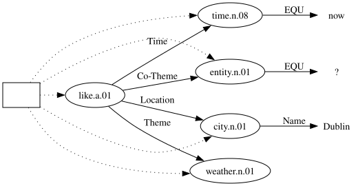
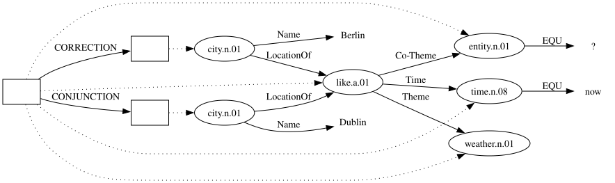
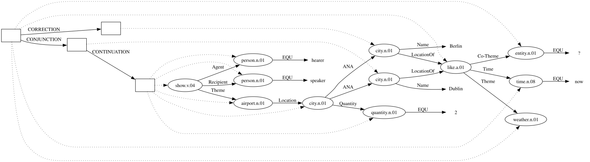
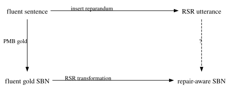
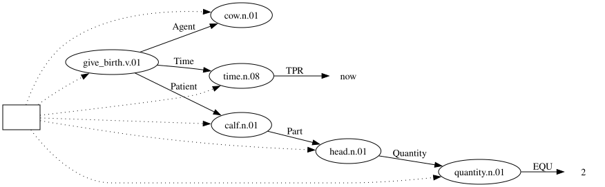
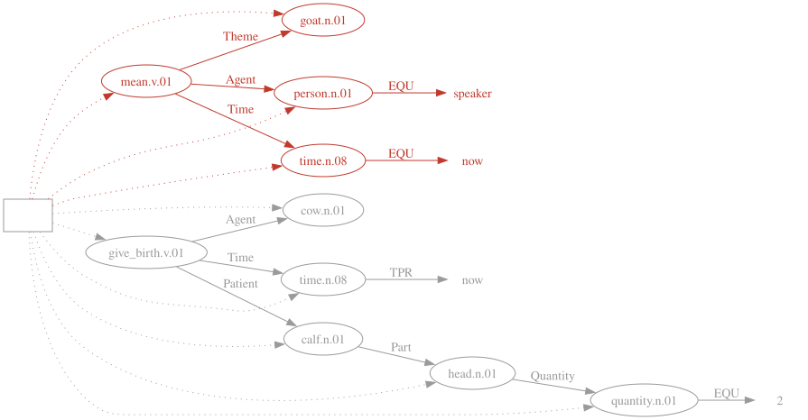
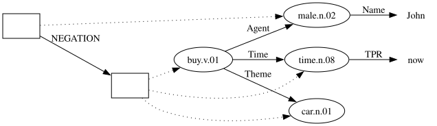
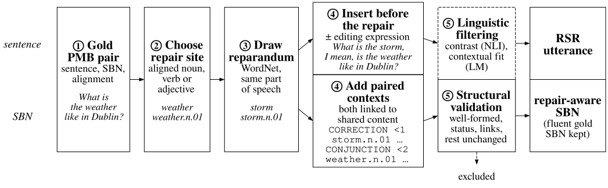

## Siri answers for the city the speaker took back

<!--
SKELETON CONVENTIONS
- Audience: Koller's group. Mostly CS, not semantic parsing. Koller has the RP; nobody else has read it.
- Principle: visual and oral presentation complement each other, but the slides alone must let the audience
  reconstruct the chain of information.
    * Section names (roadmap level) are noun phrases.
    * Slide titles are full-sentence claims. Reading the titles in order should give the argument.
    * The body holds the evidence for the title: tables, figures, examples. Claims are full sentences;
      keywords appear only as labels inside tables and figures.
- "Goal:" = speaker notes (::: {.notes}), visible in speaker view (press S).
- Slide budget: content slides <= 25; structure slides (`#` headers, one sentence of segue, no recap) <= 5.
  Title, Thank You, References and Backup do not count. A fragment-heavy walkthrough slide counts by
  speaking time, not as one slide. Check: grep -c '^## ' before '# Thank You'.
- Running examples, one job each:
    Berlin/Dublin  -> Hook, Related Work, SBN intro (fluent), Representation (the only one with later reference)
    goat/cow       -> Pilot input example only; DAGs and strings in Backup
    storm/weather  -> Data walkthrough and Experiment Design (same fluent Siri sentence, repair site "weather";
                      Berlin -> Dublin cannot be generated: proper names need an operator outside the corpus).
                      Scores: storm_weather_scores.md
- Spine: the three pieces of information a system needs (both candidates / their status / the role they
  compete for). Introduced in Related Work, used as the requirements in Representation.
- Detail goes to Backup: pull those slides up in Q&A, never in the talk.
- Source of truth for Data and Experiment Design: the RP.
-->

{width="20%" fig-align="center"}

The speaker replaces *Berlin* with *Dublin*, but Siri returns the weather for Berlin.
This is a **replacement self-repair (RSR)** [@shribergPreliminariesTheorySpeech1994].

::: {.notes}
Goal: the phenomenon is real and everyday. Name it only; the anatomy opens the Related Work section.
:::

## Current voice agents make the same mistake

Full-Duplex-Bench-v3 tests six spoken agents on real disfluent speech that requires API calls [@linFullDuplexBenchv3BenchmarkingTool2026].

| | The user says | The system fills in | The user wants |
|---|---|---|---|
| Siri | Berlin, I mean, Dublin | location = Berlin | Dublin |
| Gemini Live 3.1 | Rome, corrected to Milan | destination = Rome | Milan |

On self-corrections, the best system passes 58.8% of scenarios (GPT-Realtime) and the weakest 17.6%.

::: {.notes}
Goal: the second row is the Siri error in a current agent. The paper reports this as a case (the API is called before the correction ends), not as a rate; do not claim a proportion. TODO: verify the number of self-correction scenarios (the Pass@1 values are multiples of 1/17).
:::

## Roadmap

- **Related Work**: self-repair and how systems handle it
- **Pilot**: a current semantic parser on self-repair input
- **Representation**: a meaning representation for self-repair
- **Data**: training pairs from a meaning bank
- **Experiment Design**: training and evaluating parsers

::: {.notes}
TODO (step 2): merge with the next slide into "Two questions for this talk": RQs in plain words, roadmap sections labelled RQ1 (Representation) / RQ2 (Experiment Design).
:::

## Research questions

This project extends SBN to record all three pieces of information, and trains parsers to produce it.

1. **Representation**: How can SBN represent within-clause RSR, and what can it not cover?
2. **Parsing**: How well can LLM-based parsers learn this representation from synthesised data, and what errors remain?

::: {.notes}
TODO (step 2): merge into the Roadmap slide above. Rephrase without "SBN" (not yet introduced): a meaning representation that records the repair; parsers that learn it from synthesised data.
:::

# Related Work

## An RSR has three parts

> What is the weather like [in Berlin]~reparandum~, [I mean]~editing\ expression~, [in Dublin]~repair~?

- The **reparandum** is the material the speaker withdraws.
- The **editing expression** optionally signals the repair, e.g. *I mean*, *actually*, *no*.
- The **repair** is the material that replaces the reparandum.

This project covers replacements **within a single clause** [@leveltMonitoringSelfrepairSpeech1983; @shribergPreliminariesTheorySpeech1994].

## NLP pipelines either delete the reparandum or tag it

:::: {.columns}
::: {.column width="48%"}
### Deletion
The reparandum and the editing expression are removed, and the fluent text is passed on [@johnsonTAGbasedNoisychannelModel2004].

→ *What is the weather like in Dublin?*
:::
::: {.column width="48%"}
### Tagged transcription
The words are kept, and disfluent spans or tokens are labelled [@zayatsMultidomainDisfluencyRepair2014; @futamiStreamingJointSpeech2023].

→ *What is the weather like ~~in Berlin~~ in Dublin?*
:::
::::

Both approaches serve the same goal: recovering the speaker's final intention.

::: {.notes}
Goal: concede that this goal is right for task-oriented pipelines that only need the final request.
:::

## Deleted or tagged, the reparandum can still matter later

> What is the weather like in Berlin, I mean, in Dublin?
> Show me the airports of **these two cities**.

- After **deletion**, *these two cities* has only one antecedent left.
- After **tagging**, both names survive, but nothing records that Berlin was the location or that Dublin replaced it.

Psycholinguistic and dialogue studies show that the reparandum stays in the context [@lauLingeringEffectsDisfluent2005; @purverComputationalModelsMiscommunication2018].

::: {.notes}
Goal: first turning point of the talk.
:::

## A system needs three pieces of information about the revision

1. **Both candidates**: Berlin and Dublin
2. **Their status**: Berlin is withdrawn, Dublin is accepted
3. **The role they compete for**: the location in the weather request

All three concern what the utterance *means*, not which words were spoken.

::: {.notes}
Goal: the puzzle. Do not name the solution yet. These three items are reused as requirements (Representation); keep the wording identical.
:::

## Meaning representations make such information explicit and checkable {.small-slide}

A **meaning representation (MR)** organises entities, events and their relations into a structure that can be examined formally. In LLM-based systems, MRs make model-interpreted meaning inspectable beyond surface text:

An MR can record all three pieces of information, so an error can be traced to a missing candidate, a wrong status or a wrong role.

::: {.notes}
Goal: the answer. Argue inspectability, not performance; the thesis does not test downstream gains.
TODO (step 2): new title "A meaning representation is a graph of concepts and roles"; add the fluent Siri graph (Michael: example MR graph here) and show where each of the three pieces would sit. MR-use table moved to Backup; replace with one sentence.
:::

## SBN is the meaning representation of the Parallel Meaning Bank

- **Simplified Box Notation (SBN)** represents meaning as a sequence of **concepts** (WordNet [@millerWordNetLexicalDatabase1994] senses) and **roles** that link them [@bosQuantificationAnnotationDiscourse2021; @bosSequenceNotationCatching2023].
- Each sequence corresponds to a **directed acyclic graph (DAG)**, so an LLM can generate the graph as text.
- The Parallel Meaning Bank (PMB) 5.1.0 provides gold sentence–SBN pairs [@abzianidzeParallelMeaningBank2017].

::: {.notes}
Goal: SBN is an agreed notation; no linguistic backbone. Boxes wait until Representation.
TODO (step 2): merge into the next slide ("SBN writes this graph as a sequence an LLM can generate").
:::

## An SBN sequence and its graph encode the same meaning

*What is the weather like in Dublin?*

:::: {.columns}
::: {.column width="64%"}
::: {.small}
```{.sbn code-line-numbers="false"}
entity.n.01 EQU ?                                   % What
time.n.08 EQU now                                   % is
weather.n.01                                        % the weather
like.a.01 Co-Theme -3 Time -2 Theme -1 Location +1  % like
city.n.01 Name "Dublin"                             % in Dublin?
```
:::
Each line introduces a concept. A role points to another concept by relative position: `-1` is the previous concept, `+1` the next.
:::
::: {.column width="36%"}
{fig-align="center"}
:::
::::

::: {.notes}
Goal: the Siri request, now fluent, as the audience's first SBN.
:::

# Pilot Study

## The pilot tests a parser that cannot mark content as withdrawn

- **Parser**: Gemma-2 9B [@gemmateamGemma2Improving2024], fine-tuned with LoRA [@huLoRALowRankAdaptation2021] on fluent PMB sentence–SBN pairs only.
- **Input**: 833 sentences from the PMB training data, so the parser had seen their fluent SBNs; only the RSR inputs were new. Qwen3-32B [@yangQwen3TechnicalReport2025] inserted a reparandum of the same part of speech before one word, giving 2,499 RSR inputs without and 2,499 with *I mean*.
- **Reference**: the original fluent gold SBN, so a correct parse leaves the reparandum out [following @senSemanticParsingDisfluent2021].

::: {.notes}
TODO (step 2): new title "Can an existing SBN parser handle self-repair?"; merge with the next slide (setup + goat/cow input row).
:::

## An Example of Input
| Fluent (PMB) | RSR, no editing expression | RSR + *I mean* |
|---|---|---|
| A cow gave birth to a calf with two heads. | **A goat**, a cow gave birth to a calf with two heads. | **A goat**, *I mean*, a cow gave birth to a calf with two heads. |

::: {.notes}
Goal: the example row defines the two RSR conditions visually; no internal terms such as "unmarked".
:::

## Self-repair lowers parsing accuracy, most sharply with *I mean*

| Input | Scorable (%) | Δ | Failure-penalised F1 | Δ |
|---|---:|---:|---:|---:|
| Fluent | 97.5 | — | 0.950 | — |
| RSR, no editing expression | 94.6 | −2.9 | 0.786 | −0.164 |
| RSR + *I mean* | 76.5 | −21.0 | 0.609 | −0.341 |

- **Scorable**: the output can be converted into a graph and scored.
- **Failure-penalised F1**: SMATCH++ F1 [@opitzSMATCHStandardizedExtended2023], with unscorable outputs counted as 0.

All pairwise differences in F1 are significant (Wilcoxon signed-rank, *p* < .001).

::: {.notes}
Goal: Δ is relative to Fluent. Position effects go to Backup.
TODO (step 2): merge in the two lessons from the next slide as the takeaway lines.
:::

## Keeping the reparandum meant asserting it, and the graph score hid the error

1. In **90.1%** of scorable RSR outputs, the parser produced more concepts than for the fluent source (median +2): the reparandum was often added to the asserted content.
2. A parse that asserts the goat still scores **0.764**, so a single graph score cannot show whether the repair was handled.

::: {.notes}
Goal: the pilot shows the need for RSR supervision and for evaluation finer than SMATCH++. It does NOT show that SBN must be extended; that argument comes from later reference. Lesson 2 pays off in Experiment Design.
TODO (step 2): merge into the results slide above.
:::

# Representation

## Berlin and Dublin sit in sibling contexts under the same request

{width="85%" fig-align="center"}

::: {.notes}
Goal: the graph counterpart of the previous slide; reuse the layout of fluent_siri_example.svg so the change is visible.
TODO (step 2): new title "Keep both cities, mark Berlin as withdrawn"; annotate withdrawn / accepted / shared Location role, matching the three pieces of information. Say the NEGATION analogy in one spoken sentence (slide in Backup).
:::

## Both cities remain available for later reference; only Dublin is the requested location

> Show me the airports of **these two cities**.

{width="100%" fig-align="center"}

*These two cities* links to both Berlin and Dublin (`ANA`), but Berlin does not become the requested location again.

::: {.smaller}
Berlin stays accessible because proper names project out of the withdrawn context [@bosVariablefreeDiscourseRepresentation2021]. The later-reference test set only uses referents that can project in this way.
:::

::: {.notes}
Goal: close the loop opened in Related Work. The DAG carries the claim; one sentence states it, the small note states the mechanism and its limit. If the final DAG is too tall, switch to two columns (text left, DAG right).
:::

## The representation covers concept and role replacement; the corpus implements single concepts {.small-slide}

| | |
|---|---|
| **Representable** | Replacement of a concept or a role, also inside a context such as negation |
| **Implemented in the corpus** | Replacement of a single noun, verb or adjective concept |
| **Outside the design** | Replacement of a separator (e.g. *must* → *might*, *when* → *even though*); delayed repair |

::: {.notes}
Goal: keep "representable" and "implemented" apart; this is where the sharpest questions will land. Why not AMR or DS-TTR: Backup.
:::

# Data

## No corpus pairs self-repair with SBN, so PMB pairs are transformed on both sides {.small-slide}

The PMB has fluent sentence–SBN pairs; disfluency corpora have self-repairs but no SBN [@deshmukhResegmentationSWITCHBOARD1998; @passaliLARDLargescaleArtificial2022; @guptaDisflQABenchmarkDataset2021].

{width="70%" fig-align="center"}

Each item keeps the PMB split of its source document, so no training document reappears in evaluation.

::: {.notes}
Goal: why the data is generated, and how: both sides of a gold pair change together. Callback: the pilot changed only the input. The dashed "?" edge is what Experiment Design tests.
:::

## Step ①–③: pick a concept, draw a competitor

::: {.notes}
TODO (step 2): fluent Siri pair (sentence lane + SBN lane) -> pick "weather" / weather.n.01 -> draw "storm" / storm.n.01 from WordNet, same part of speech. Fragments, one step each. Full pipeline figure in Backup.
:::

## Step ④: edit both sides together

::: {.notes}
TODO (step 2): sentence side inserts the reparandum (± editing expression); SBN side adds CORRECTION / CONJUNCTION (generator output: anchor construction, see storm_weather_scores.md). Same visual structure as the Berlin/Dublin representation slide. Surface form pending the retracing decision.
:::

## Step ⑤: keep only legal and sensible pairs

Legal is not yet good: candidates are filtered for **semantic contrast** with bidirectional NLI [@laurerLessAnnotatingMore2024] (*couch → sofa* fails) and for **contextual fit** with the reparandum's surprisal given its left context (*cake → carburettor, for his wedding* fails). Both thresholds are set on a labelled sample and frozen before filtering.

::: {.notes}
TODO (step 2): structural check + the two filters, each with its failing example; storm/weather passes both.
:::

## The transformation yields a legal graph at 99.7% of usable sites {.small-slide}

| Stage (PMB training partition) | Count | % of lexical concepts |
|---|---:|---:|
| Lexical concepts (noun, verb, adjective) | 23,232 | 100.0 |
| Aligned to an uttered word | 17,886 | 77.0 |
| Usable site with a WordNet reparandum | 16,481 | 70.9 |
| Structurally legal transformation | 16,425 | 70.7 |

The paired configuration applies almost wherever a reparandum can be inserted, which is the empirical side of RQ1's coverage question.

::: {.notes}
Goal: structural generation and validation are complete; linguistic filtering, the independent audit and final sampling remain. Most of the alignment loss is verbs without a surface word. Scope: immediate replacement of aligned noun, verb and adjective concepts, written PMB contexts; the experiments test learnability within these boundaries, not coverage of spontaneous RSR.
TODO (step 2): retitle "How much data this yields"; present as the candidate pool before linguistic filtering and sampling (known numbers only); 99.7% as one sentence.
:::

# Experiment Design

## Two conditions with identical inputs isolate the effect of the target representation {.small-slide}

| Condition | RSR inputs | Target for RSR inputs | Corresponds to | 2B | 9B | 27B |
|---|---|---|---|:-:|:-:|:-:|
| Fluent only | no | — | the pilot parser | ✓ | ✓ | ✓ |
| RSR normalisation | yes | fluent gold SBN | deletion | ✓ | ✓ | ✓ |
| Repair-aware | yes | repair-aware SBN | this project | ✓ | ✓ | ✓ |

- Qwen3.5 at three sizes [@qwenQwen35Native2026], LoRA, one parsing instruction that does not say whether an input contains an RSR.
- Within each model size, the two RSR conditions share inputs, example counts and training procedure; **only the target differs**.
- Every size is trained under all three conditions with three matched seeds: 27 runs.

::: {.notes}
Goal: the rows of the comparison table become training conditions. Fluent only vs repair-aware changes both the examples and the targets, so it is a reference, not the controlled comparison. Every size × condition has three matched seeds (27 runs), so the target effect can be compared across model capacities. Qwen3.5 because it is the most recent family with dense checkpoints across the sizes needed. Normalisation is an end-to-end parser, not a pipeline.
TODO (step 2): "Same inputs, different targets" with the storm/weather item; label the roles explicitly: Fluent only = reference (the pilot parser), RSR normalisation = baseline (deletion), Repair-aware = this project; say which RQ aspect each serves.
:::

## A single graph score cannot separate opposite failures {.small-slide}

*Let's stand, I mean, sit in the shade.*

| Output | Typical of | SMATCH++ | RSR-structure accuracy | Accepted meaning |
|---|---|---|:-:|:-:|
| *stand* dropped, fluent graph | normalisation | partial | ✗ | ✓ |
| *stand* and *sit* both asserted | the pilot parser | partial | ✗ | ✗ |
| *stand* withdrawn, *sit* accepted | repair-aware target | full | ✓ | ✓ |

- **RSR-structure accuracy**: paired contexts, correct **status**, required **links** to shared content: the three pieces of information.
- **Accepted meaning**: the prediction without its withdrawn context, scored against the fluent gold graph.

::: {.notes}
Goal: callback to the pilot's 0.764: the first two rows get partial graph credit for opposite reasons. The component scores of RSR-structure accuracy show which requirement failed.
TODO (step 2): replace stand/sit with storm/weather and the scores in storm_weather_scores.md; keep only the SMATCH++ column here, the two new measures go to the next slide.
:::

## Two measures separate them

::: {.notes}
TODO (step 2): add RSR-structure accuracy and accepted meaning as columns to the storm/weather table (✓/✗ per row); then one line per question: learnable? / what does keeping the reparandum buy? / what does it cost? — which measure answers each. Old evaluation matrix in Backup.
:::

## Further tests check that the parser learned the distinction, not a surface pattern {.small-slide}

| Possible shortcut | Test |
|---|---|
| The editing expression triggers the structure | About 30% of RSR training inputs carry *I mean*, *no*, *no wait* or *actually*. Each test item comes with and without one; *sorry* never appears in training |
| Any two adjacent competing words trigger the structure | Lists, appositions and coordination without replacement (non-RSR set) |
| The configuration is applied beyond its scope | Corrections across discourse turns |

::: {.notes}
Goal: answer the obvious objection to synthetic data before it is raised. The non-RSR documents are held out of training (9,447 training documents remain). Error categories: Backup.
TODO (step 2): one concrete example per row (with / without "I mean", unseen "sorry", a list such as "Berlin, Dublin and Paris").
:::

## Summary: keep both cities, mark the withdrawn one {.small-slide}

| | |
|----|------------|
| **Related Work** | Deletion loses Berlin; tagging keeps it but not its status or its role. |
| **Pilot** | A parser trained on fluent SBN often asserts the reparandum, and SMATCH++ hides the error. |
| **Representation** | Pairing `CORRECTION` with `CONJUNCTION` records both candidates, their status and the role they compete for. |
| **Data** | Transforming PMB pairs on both sides yields a legal graph at 99.7% of usable sites. |
| **Experiment Design** *(planned)* | Three conditions at three model sizes test whether the structure is learnable, and what keeping the reparandum buys and costs. |

Back to Siri: a parser that produces this representation queries the weather in Dublin, and can still resolve *these two cities* to Berlin and Dublin.

::: {.notes}
Goal: one sentence per roadmap section, in the same words as the section's key slide, so the chain can be reread here. Only the first four rows are findings; Experiment Design is the plan. Close on Siri: the accepted meaning gives the right API call, the kept reparandum serves later reference.
:::

## Status and Timeline

- **done**: pilot; representation; structural generation over the PMB training partition
- **next**: freeze filtered data and challenge sets → 27 training runs → evaluation → thesis (14 Dec)

::: {.notes}
Goal: feasibility. RP timeline: filters calibrated and frozen, challenge sets and evaluation toolkit completed by 4 Oct; the 27 runs from 5 Oct to 1 Nov.
:::

# Thank You

# References

::: {#refs}
:::

# Backup

## Meaning representations in LLM-based systems {.small-slide}

| MR use | Study |
|---|---|
| Detect unsupported relations in generated database queries | @reganMASSIVEMultilingualAbstract2024 |
| Evaluate the contextual appropriateness of dialogue responses | @yangEmphasisingStructuredInformation2025 |
| Construct paraphrase-resistant semantic watermarks | @yeSWANSemanticWatermarking2026 |

## Pilot: Full Results and Position Effects

## Recognition Probe: the failure is not only a failure to notice the repair

The base Gemma-2 9B, without the adapter, was asked to mark the reparandum, the editing expression and the repair in plain text.

| Input | RSR detected (%) |
|---|---:|
| Fluent (false alarm) | 1.0 |
| RSR, no editing expression | 44.8 |
| RSR + *I mean* | 100.0 |

With *I mean*, the base model notices every repair, yet the fine-tuned parser often represents *I mean* as content. Without it, the base model misses more than half.

::: {.notes}
Goal: pre-empt "the parser just didn't notice the repair". State the limit before anyone asks: the probe changes the task and removes the adapter, so it cannot isolate SBN generation as the error source. The gap with and without an editing expression motivates the paired test items in Data. Span F1 and position breakdown go to Backup.
:::

## Goat/Cow: the parser asserts the reparandum and turns *I mean* into an event

*A goat, I mean, a cow gave birth to a calf with two heads.*

:::: {.columns}
::: {.column width="48%"}
**Fluent reference**

{width="100%"}
:::
::: {.column width="48%"}
**Parse of the RSR input**

{width="100%"}
:::
::::

Most of the graph matches the reference, so the parse still scores **0.764** SMATCH++. Nothing in it records that the cow replaces the goat.

::: {.notes}
Goal: the DAGs replace the SBN strings (strings on the next slide). The picture explains the 0.764: a correct graph with extra structure grown onto it.
:::

## Goat/Cow: SBN Strings

*A goat, I mean, a cow gave birth to a calf with two heads.*

:::: {.columns}
::: {.column width="48%"}
Fluent reference
```{.sbn code-line-numbers="false"}
cow.n.01                                     % cow
give_birth.v.01 Agent -1 Time +1 Patient +2  % gave birth
time.n.08 TPR now
calf.n.01 Part +2                            % calf
quantity.n.01 EQU 2                          % two
head.n.01 Quantity -1                        % heads
```
:::
::: {.column width="48%"}
Parse of the RSR input
```{.sbn code-line-numbers="false"}
goat.n.01                                    % goat
person.n.01 EQU speaker                      % I
mean.v.01 Theme -2 Agent -1 Time +1          % mean
time.n.08 EQU now
cow.n.01                                     % cow
give_birth.v.01 Agent -1 Time +1 Patient +2  % gave birth
time.n.08 TPR now
calf.n.01 Part +2                            % calf
quantity.n.01 EQU 2                          % two
head.n.01 Quantity -1                        % heads
```
:::
::::

## No current approach records the revision in the meaning

| | Both candidates | Their status | The role they compete for |
|---|:-:|:-:|:-:|
| Deletion | ✗ | — | — |
| Tagged transcription | ✓ | ✓ (on words) | ✗ |
| Parser trained on fluent SBN (pilot) | ✓^a^ | ✗ | ✗ |
| **This project** | ✓ | ✓ (in the meaning) | ✓ |

::: {.smaller}
^a^ 90.1% of scorable outputs contain more concepts than the fluent parse; the reparandum is often kept as asserted content.
:::

::: {.notes}
Goal: the columns are the three pieces of information from Related Work; the table needs no example to be read.
:::

## SBN can already keep content without asserting it: contexts

*John did not buy a car.*

:::: {.columns}
::: {.column width="50%"}
::: {.small}
```{.sbn code-line-numbers="false"}
male.n.02 Name "John"               % John
    NEGATION <1                     % did not
time.n.08 TPR now
buy.v.01 Agent -2 Time -1 Theme +1  % buy
car.n.01                            % a car
```
:::
:::
::: {.column width="50%"}
{.nostretch width="100%" fig-align="center"}
:::
::::

- A **separator** such as `NEGATION` opens a new **context**: the buying event and the car are represented, but their content is denied.
- **Accessibility**: a link may reach out of the negated context (to John), but not into it.

::: {.notes}
Goal: the first piece of information (keep the reparandum without asserting it) needs exactly this device.
:::

## `CORRECTION` holds the withdrawn candidate, `CONJUNCTION` the accepted one {.small-slide}

```{.sbn code-line-numbers="false"}
entity.n.01 EQU ?                       % What
time.n.08 EQU now                       % is
weather.n.01                            % the weather
like.a.01 Co-Theme -3 Time -2 Theme -1  % like
    CORRECTION <1
city.n.01 Name "Berlin" LocationOf -1   % in Berlin
    CONJUNCTION <2                      % I mean,
city.n.01 Name "Dublin" LocationOf -2   % in Dublin?
```

- `CORRECTION` opens the context for Berlin. Following SDRT's *Correction* relation, its content is withdrawn: ¬K~π1~ ∧ K~π2~ [@lascaridesAgreementDisputesCommitments2009].
- `CONJUNCTION` opens the context for Dublin and merges it back into the shared request.
- Both cities link to the weather request with `LocationOf`, so the revised role is recorded.

::: {.notes}
Goal: the three pieces of information, met one per bullet. RP wording: the representation pairs the existing separators CORRECTION and CONJUNCTION and introduces no new separator. If pressed on data: CORRECTION does not occur in PMB 5.1.0 gold.
:::

## Abstract Description

:::{.text-center}

$$
K = K_{\pi_{\text{pre}}} \land \neg K_{\pi_m} \land \big(K_{\pi_n} \land K_{\pi_{\text{post}}}\big) \land \varphi_{\mathit{Corr}(\pi_m,\pi_n)}
$$
:::

where:
$K_{\pi_m}$ represents the reparandum
$K_{\pi_n}$ represents the repair
$K_{\pi_{\text{post}}}$ represents the continuation after the repair

## Why Not AMR or DS-TTR

Why SBN rather than AMR [@banarescuAbstractMeaningRepresentation2013] or DS-TTR [@houghProcessingSelfrepairsIncremental2012]: AMR lacks separate semantic contexts and does not record the order of the replacement; DS-TTR keeps the withdrawn path only in its processing history. SBN separates contexts, and the PMB supplies sentence–SBN pairs.

## Each item edits a gold pair on both sides, then checks both sides

{width="100%" fig-align="center"}

::: {.smaller}
Running example: the Siri request. The reparandum, the utterance and the SBN splice are the generator's actual output for this sentence. Dashed: in progress.
:::

::: {.notes}
Goal: the intuition of data synthesis in one picture. Top lane = sentence, bottom lane = SBN, as in the previous square. Steps ② and ③ span both lanes because the word–concept alignment ties a word to a concept. Step ④ is where the two sides are edited in parallel; "linked to shared content" covers the direct, anchor and movement constructions (this example uses the anchor construction; see Backup). The step names match the rows of the yield table. Berlin → Dublin is NOT used here: proper names need a separate operator that is not part of the implemented corpus.
TODO: the utterance in the figure retraces "is the"; fix once the retracing decision is made.
:::

## Anchor and Movement Constructions

- **Anchor**: *Josh, I mean, Mary bought a cake*: shared `entity.n.01`, both candidates `EQU` it
- **Movement**: *Tom opened, no, broke the window*: *window* moved before the paired contexts

::: {.notes}
Goal: operational conventions for sites where the direct construction fails. Show only if asked; full listings from RP Appendix.
:::

## RSR-structure accuracy shows learnability; the two RSR conditions show benefit and cost {.small-slide}

| Question | Comparison | Measure | Test data |
|---|---|---|---|
| Can the representation be learned? | repair-aware, absolute | RSR-structure accuracy, error types | generated RSR test items |
| What does keeping the reparandum buy? | normalisation vs repair-aware | links to the withdrawn referent | later-reference challenge set |
| What does it cost? | normalisation vs repair-aware | accepted meaning | generated RSR test items |
| | all conditions | SMATCH++, spurious-RSR rate | unmodified PMB test set |

RSR-structure accuracy, the primary measure, is read in absolute terms: the repair-aware parser is expected to lead the other conditions on it, since only it is trained on that structure.

::: {.notes}
Goal: the full evaluation matrix. The design sets no threshold for declaring the richer representation cost-free; paired differences show the size of any cost.
:::

## Error Categories

Errors are classified as missing configuration, reversed status, wrong link to shared content, reparandum left in accepted content, editing expression represented as content, spurious RSR, or malformed SBN.

::: {.notes}
Goal: the error categories are fixed before the test outputs are inspected.
:::

## Statistics {.small-slide}

- **Unit of observation**: the PMB source document; all variants of a source are averaged before comparison.
- **Seeds**: for each model size and matched seed, paired document-level differences with 95% confidence intervals from 10,000 paired bootstrap samples; within each size, the mean and range of the three differences summarise training variation. A result counts as stable only when all three differences have the same direction.
- **Multiple comparisons**: Holm correction within each family of secondary comparisons.

::: {.notes}
Goal: RP Appendix "Statistical Comparisons". Show only if asked.
:::
