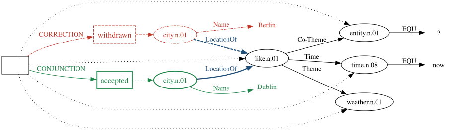
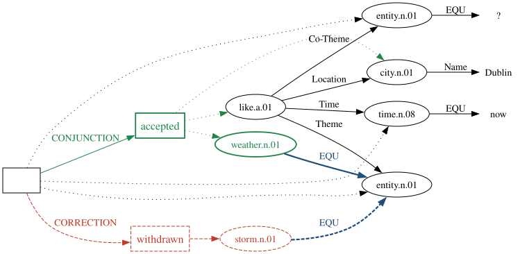
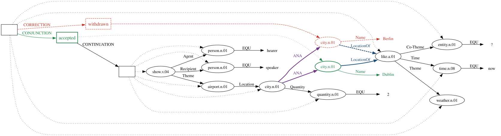
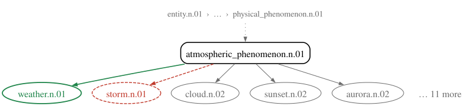

## Siri answers for the city the speaker took back

<!--
SKELETON CONVENTIONS
- Audience: Koller's group. Mostly CS, not semantic parsing. Koller has the RP; nobody else has read it.
- Principle: visual and oral presentation complement each other, but the slides alone must let the audience
  reconstruct the chain of information.
    * Section names (roadmap level) are noun phrases.
    * Slide titles are full-sentence claims. Reading the titles in order should give the argument.
    * The body holds the evidence for the title: tables, figures, examples. Claims are full sentences;
      keywords appear only as labels inside tables and figures.
- "Goal:" = speaker notes (::: {.notes}), visible in speaker view (press S).
- Slide budget: content slides <= 25; structure slides (`#` headers, one sentence of segue, no recap) <= 5.
  Title, Thank You, References and Backup do not count. A fragment-heavy walkthrough slide counts by
  speaking time, not as one slide. Check: grep -c '^## ' before '# Thank You'.
- Running examples, one job each:
    Berlin/Dublin  -> Hook, Related Work, SBN intro (fluent), Representation (the only one with later reference)
    goat/cow       -> Pilot input example only; DAGs and strings in Backup
    storm/weather  -> Data walkthrough AND Experiment Design (same fluent Siri sentence, repair site "weather";
                      Berlin -> Dublin cannot be generated: proper names need an operator outside the corpus).
                      A constructed item, not a PMB document: it illustrates, it is never a test item.
                      No model scores: nothing has been run.
    stand/sit      -> Backup only (RP worked record p42/d1468, #/bk-record).
    Berlin/Dublin returns in Experiment Design as the later-reference challenge.
- Spine: the three pieces of information a system needs (both candidates / their status / the role they
  compete for). Introduced in Related Work, used as the requirements in Representation.
- Detail goes to Backup: pull those slides up in Q&A, never in the talk.
- Source of truth for Data and Experiment Design: the RP.
-->

{width="20%" fig-align="center"}

The speaker replaces *Berlin* with *Dublin*, but Siri returns the weather for Berlin.
This is a **replacement self-repair (RSR)** [@shribergPreliminariesTheorySpeech1994].

::: {.notes}
Let's start with an example. I took this screenshot a couple of days ago. I asked the voice assistant on my phone about the weather in Berlin, but then I changed my mind to Dublin.
**This**, saying something and then correcting it yourself, is what linguists call a "replacement self-repair".
As you can see, the transcription is correct. But it returns the weather for Berlin, the city I had just taken back.
:::

## Current voice agents make the same mistake

Full-Duplex-Bench-v3 tests six spoken agents on real disfluent speech that requires API calls [@linFullDuplexBenchv3BenchmarkingTool2026].

| | The user says | The system fills in | The user wants |
|---|---|---|---|
| Siri | Berlin, I mean, Dublin | location = Berlin | Dublin |
| Gemini Live 3.1 | Rome, corrected to Milan | destination = Rome | Milan |

On self-corrections, the best system passes 58.8% of scenarios (GPT-Realtime) and the weakest 17.6%.

::: {.notes}
In fact, this problem is not rare, even in current LLM-based systems. A recent benchmark study found that Gemini Live 3.1 made the same mistake: it sent the withdrawn content to the API, and of course returned the wrong answer.

Prepare for answer: If people ask about the actual performance and test size: the benchmark has 100 recorded scenarios from 12 speakers; 21 of them are designed as self-corrections (paper, Introduction; also the released scenario file). The self-correction Pass@1 in Table 3 is 0.588 for GPT-Realtime, 0.353 for Gemini Live 3.1 and 0.176 for the cascaded pipeline. Say "about twenty scenarios": the Table 3 values are all multiples of 1/17, and the paper does not explain the gap to 21. The Rome/Milan case is Table 8: Gemini Live 3.1 called the API 2.27 s before the user finished correcting.
:::

## This project asks two questions

1. **RQ1**: How can a meaning representation record a self-repair, keeping what was withdrawn, and what can it not cover?
2. **RQ2**: How well can LLM-based parsers learn this representation from synthesised data, and what errors remain?

&nbsp;

::: {.center}
Related Work → Pilot → **Representation** (RQ1) → Data → **Experiment Design** (RQ2)
:::

::: {.notes}
So this project asks two research questions. The first is how to design a meaning representation that can capture this phenomenon. The second is how well an LLM-based parser can learn this representation. What a meaning representation is, and why we need one here, I will explain in the next section.

For the rest of this talk, I will first review existing work on self-repair, then report the pilot study I have completed. In the Representation section, I will show the formalism I designed, which answers RQ1. After that, I will show how the parsing experiment is designed to answer RQ2.
:::

# Related Work

## Anatomy: An RSR has three parts

> What is the weather like [in Berlin]~reparandum~,\
> [I mean]~editing\ expression~, [in Dublin]~repair~?

- The **reparandum** is the material the speaker withdraws.
- The **editing expression** optionally signals the repair, e.g. *I mean*, *actually*, *no*.
- The **repair** is the material that replaces the reparandum.

This project covers replacements **within a single clause** [@leveltMonitoringSelfrepairSpeech1983; @shribergPreliminariesTheorySpeech1994].

:::{.notes}
In disfluency research, a self-repair is usually split into three parts. The reparandum is what the speaker takes back, here "in Berlin". The repair is what replaces it, "in Dublin", and it shows what the speaker finally means. Between the two there may be an editing expression. In English, common ones are "actually" and "I mean".
:::

## NLP pipelines either delete the reparandum or tag it

:::: {.columns}
::: {.column width="48%"}
### Deletion
The reparandum and the editing expression are removed, and the fluent text is passed on [@johnsonTAGbasedNoisychannelModel2004].

→ *What is the weather like in Dublin?*
:::
::: {.column width="48%"}
### Tagged transcription
The words are kept, and disfluent spans or tokens are labelled [@zayatsMultidomainDisfluencyRepair2014; @futamiStreamingJointSpeech2023].

→ *What is the weather like ~~in Berlin~~ in Dublin?*
:::
::::

Both approaches serve the same goal: recovering the speaker's final intention.

::: {.notes}
NLP pipelines mainly use two methods: deletion and tagged transcription. With deletion, the disfluent part, the reparandum and the optional editing expression, is removed. So the later components in the pipeline never see that the speaker said "in Berlin".
With tagged transcription, the disfluent part is kept, but it is labelled as disfluent.
:::

## Later Reference: Deleted or tagged, the reparandum can still matter later

> What is the weather like in Berlin, I mean, in Dublin?
> Show me the airports of **these two cities**.

- After **deletion**, *these two cities* has only one antecedent left.
- After **tagging**, both names survive and Berlin is marked as withdrawn, but nothing links either city to the weather request.

Psycholinguistic [@lauLingeringEffectsDisfluent2005] and computational linguistic studies [@purverComputationalModelsMiscommunication2018] show that the reparandum stays in the context.

::: {.notes}
However, both methods have a problem with examples like this one. "These two cities" refers back to both the withdrawn reparandum and the repair.

This has been observed in both psycholinguistic and computational linguistic studies.

As you can imagine, deletion loses one of the two cities. Tagged transcription looks better, but the tags still don't say how the disfluent part relates to the rest of the sentence. So a downstream model may need extra inference to get it right.
:::

## A system needs three pieces of information about the revision

1. **Both reparandum and repair**: Berlin and Dublin
2. **Their status**: Berlin is withdrawn, Dublin is accepted
3. **The role they compete for**: the location in the weather request

Tags on words can hold the first two. The third is a relation between meanings, so it needs a representation of meaning.

::: {.notes}
To solve this puzzle, we need a solution that meets all three requirements. It should keep the reparandum and the repair, as tagged transcription does. But it should also record the structural relation between them: who replaces whom, and in which role.
:::

## A meaning representation is a graph of concepts and roles {.small-slide}

*What is the weather like in Dublin?*

:::: {.columns}
::: {.column width="58%"}
{width="100%" fig-align="center"}
:::
::: {.column width="42%"}
- **Nodes** are concepts: *weather*, *like*, a *city* named Dublin.
- **Edges** are roles: the city is the **Location** of the weather request.
- The **box** on the left is a context: it holds everything the speaker asserts.
:::
::::

Such a graph has room for all three pieces of information: two city nodes, a context for each, and one Location role. Because the structure is explicit, an output can be checked piece by piece.

::: {.notes}
These requirements bring us to meaning representations. Meaning representation is a central topic in computational semantics. It maps natural language to a formal, symbolic structure, so that machines can compute with meaning.

Meaning representations are usually written as human-readable strings or graphs, so we can inspect them.

If asked where MRs are used with LLMs: Backup table. The box is introduced here so that two boxes on the Representation slide need no explanation.
:::

## SBN writes this graph as text, so an LLM can generate it {.small-slide}

*What is the weather like in Dublin?*

:::: {.columns}
::: {.column width="64%"}
::: {.small}
```{.sbn code-line-numbers="false"}
entity.n.01 EQU ?                                   % What
time.n.08 EQU now                                   % is
weather.n.01                                        % the weather
like.a.01 Co-Theme -3 Time -2 Theme -1 Location +1  % like
city.n.01 Name "Dublin"                             % in Dublin?
```
:::
Each line introduces a concept. A role points to another concept by relative position: `-1` is the previous concept, `+1` the next.
:::
::: {.column width="36%"}
{fig-align="center"}
:::
::::

**Simplified Box Notation (SBN) [@bosSequenceNotationCatching2023; @bosQuantificationAnnotationDiscourse2021]** is the format of the Parallel Meaning Bank (PMB 5.1.0), which provides gold sentence–SBN pairs [@abzianidzeParallelMeaningBank2017].  

Semantic parsing then becomes text-to-text: sentence in, SBN out.

::: {.notes}
For this project, I use Simplified Box Notation, or SBN for short. It was developed by Johan Bos at the University of Groningen. It has two advantages that suit this project well.

First, an SBN representation is a string and a graph at the same time. Because it is written as a sequence, it fits end-to-end machine learning.

Second, SBN is the annotation format of the Parallel Meaning Bank, so there are thousands of gold sentence–SBN pairs already. These pairs are the raw material for the data I generate later.

(Do not mention scope here. The box was introduced on the previous slide; its "keep without asserting" use is stated once, on the Representation slide, where it pays off.)
:::

# Pilot Study

:::{.notes}
Next, I will report what happens when we train an SBN parser on fluent data and ask it to parse sentences with a self-repair.
:::

## Can an existing SBN parser handle self-repair? {.small-slide}

- **Parser**: Gemma-2 9B [@gemmateamGemma2Improving2024], fine-tuned with LoRA [@huLoRALowRankAdaptation2021] on PMB train gold split (all fluent).
- **Input**: 833 PMB sentences with an inserted reparandum, with and without *I mean* (2,499 each).

| Fluent (PMB) | RSR, no editing expression | RSR + *I mean* |
|---|---|---|
| A cow gave birth to a calf with two heads. | **A goat**, a cow gave birth to a calf with two heads. | **A goat**, *I mean*, a cow gave birth to a calf with two heads. |

**Correct answer for all three inputs**: the same fluent gold SBN, with the reparandum left out [following @senSemanticParsingDisfluent2021].

::: {.notes}
For this pilot study, I used Gemma 2 9B, fine-tuned with LoRA on the gold training split of the PMB.

For the test data, I took 833 sentences from the same pool and used Qwen3 32B to insert a reparandum into each sentence. For each sentence, I made three RSR variants. Then I made a second version of each variant, with "I mean" between the reparandum and the repair. As you see in the table, all three inputs share one answer: the fluent SBN, because the reparandum counts as withdrawn.

So the bar is deliberately low: fluent SBN has no way to mark the goat as withdrawn, so the parser only has to leave it out.

If asked: the 833 sentences come from the training data, so the parser had seen their fluent SBNs; only the RSR inputs were new.
:::

## Self-repair lowers parsing accuracy, and the parser asserts the reparandum {.small-slide}

| Input | Scorable (%) | Rel. Δ | Failure-penalised F1 | Rel. Δ |
|---|---:|---:|---:|---:|
| Fluent | 97.5 | — | 0.950 | — |
| RSR, no editing expression | 94.6 | −3.0% | 0.786 | −17.3% |
| RSR + *I mean* | 76.5 | −21.5% | 0.609 | −35.9% |

- In **90.1%** of scorable RSR outputs the parse has more concepts than the fluent one. The extra concepts often include the reparandum, which the parse then asserts as content.
- Fluent SBN offers only two options for the goat: drop it or assert it. The parser mostly asserts it.

::: {.smaller}
Scorable: the output converts into a graph. F1: SMATCH++ [@opitzSMATCHStandardizedExtended2023], unscorable outputs counted as 0. Rel. Δ: change relative to Fluent.
:::

::: {.notes}
The results show two things. First, a clear pattern: the more we insert, the worse the parser does. Second, the parser mostly keeps both the reparandum and the repair, and sometimes the editing expression too. How do we know? When I compare the outputs with the reference SBN, 90% of the outputs have more concepts.

Bridge to the next section: with fluent SBN, the parser can only drop the goat or assert it. The representation I propose adds a third option: keep the goat, but mark it as withdrawn.
(Careful: the pilot shows the need for RSR training data and for an evaluation finer than one graph score. It does not show that SBN must be extended; that argument comes from later reference.)
:::

# Representation

## Keep both cities, and mark Berlin as withdrawn

*What is the weather like in Berlin, I mean, in Dublin?*

{width="100%" fig-align="center"}

| Both candidates | Their status | The role they compete for |
|:-:|:-:|:-:|
| two `city` nodes | a withdrawn and an accepted context | both are `LocationOf` the request |

::: {.notes}
I designed an extension to represent RSR in SBN. It uses two separators. The idea is: CORRECTION quarantines the reparandum, and CONJUNCTION merges the repair back into the rest of the graph.

SBN already has boxes that hold content without asserting it; this is how negation works. I reuse that mechanism, and both separators already exist in SBN.

Let's check the three requirements from earlier.

First, both Berlin and Dublin are kept: check. Second, Berlin sits in the withdrawn CORRECTION box and Dublin in the accepted CONJUNCTION box: check. Third, both are linked to the weather request by LocationOf, so the role they compete for is recorded too: check.

Like before, this graph is written line by line as an SBN string; you will see one in the Data section.
If asked for the string now: Backup "CORRECTION holds the withdrawn candidate". If asked about negation: Backup "John did not buy a car".
:::

## Both cities remain available for later reference; only Dublin is the requested location

> Show me the airports of **these two cities**.

{width="100%" fig-align="center"}

*These two cities* links to both Berlin and Dublin (`ANA`), but Berlin does not become the requested location again.

::: {.smaller}
Berlin stays accessible because proper names project out of the withdrawn context [@bosVariablefreeDiscourseRepresentation2021]. The later-reference test set only uses referents that can project in this way.
:::

::: {.notes}
This directly answers the later-reference problem. An ANA edge connects "these two cities" back to both Berlin and Dublin, so the two sentences can be represented by one well-formed SBN.
:::

## The representation covers concept and role replacement; the corpus implements single concepts {.small-slide}

| | |
|---|---|
| **Representable** | Replacement of a concept or a role, also inside a context such as negation |
| **Implemented in the corpus** | Replacement of a single noun, verb or adjective concept |
| **Outside the design** | Replacement of a separator (e.g. *must* → *might*, *when* → *even though*); delayed repair |

::: {.notes}
Finally, this extension can represent the replacement of a concept or a role, also inside a context such as negation. The corpus I generate implements the simplest part of this: replacing a single noun, verb or adjective.

The limitation is also clear. When the replaced item is itself a separator, such as a modal (must → might) or a discourse relation (when → even though), this extension cannot represent it. One example is "I helped my mum when, even though I was busy". Delayed repairs are also outside the design.
:::

# Data
:::{.notes}
Now to the data. I will explain how I turn this representation into real data for training and testing.
:::

## No corpus pairs self-repair with SBN, so PMB pairs are transformed on both sides {.small-slide}

The PMB has fluent sentence–SBN pairs; disfluency corpora have self-repairs but no SBN [@deshmukhResegmentationSWITCHBOARD1998; @passaliLARDLargescaleArtificial2022; @guptaDisflQABenchmarkDataset2021].

{width="70%" fig-align="center"}

Each item keeps the PMB split of its source document, so no training document reappears in evaluation.

::: {.notes}
One of the main challenges of this project is that disfluency corpora contain RSR but no meaning representations, while the PMB has high-quality meaning representations but no RSR. So I am building a data synthesis pipeline. That is the rightmost arrow in the diagram.
:::

## Steps ①–③: pick a concept, draw a competitor for it

<table>
<thead><tr><th>Step</th><th>Sentence side</th><th>SBN side</th></tr></thead>
<tbody>
<tr><td>① Start from a gold PMB pair</td><td><em>What is the weather like in Dublin?</em></td><td>the SBN shown earlier</td></tr>
<tr class="fragment"><td>② Pick a noun, verb or adjective that a word expresses</td><td><em>weather</em></td><td><code>weather.n.01</code></td></tr>
<tr class="fragment"><td>③ Draw a concept with the same WordNet parent</td><td><em>storm</em></td><td><code>storm.n.01</code></td></tr>
</tbody>
</table>

::: {.fragment}
Other siblings of *weather* in the pool: *cloud*, *sunset*, *aurora*, *halo*, … The pool takes siblings only, so WordNet synonyms of *weather* are excluded.
:::

::: {.notes}
Let's walk through it step by step. This is an intuitive demonstration; some details are still being settled.

First, we choose a PMB pair from the corpus. For this walkthrough, we use the example from earlier. Now we have the sentence and its meaning representation.

Next, we choose a word, and for this word we find a "sibling" in WordNet. Here, we choose storm.
WordNet organises words, especially nouns, in a hierarchy of more general and more specific terms. So the siblings of "weather" are also weather-related.
:::

## Step ④: edit both sides of the pair together

*What is the weather like in Dublin?* → *What is **the storm**, I mean, the weather like in Dublin?*

::: {.small}
```{.sbn code-line-numbers="3-7"}
entity.n.01 EQU ?                                    % What
time.n.08 EQU now                                    % is
entity.n.01                                          % both fill this slot
    CORRECTION <1                                    % withdrawn:
storm.n.01 EQU -1                                    %   the storm
    CONJUNCTION <2                                   % accepted (I mean):
weather.n.01 EQU -2                                  %   the weather
like.a.01 Co-Theme -5 Time -4 Theme -3 Location +1   % like
city.n.01 Name "Dublin"                              % in Dublin?
```
:::

As with Berlin and Dublin, the item has a withdrawn and an accepted context, and both candidates compete for one role, the Theme of *like*.

::: {.notes}
Now that we have all the material, the next step is to do Lego on both sides. We insert the chosen word **in front of** the original word. The meaning of the original sentence stays the same; it just gets a reparandum, and so it becomes an RSR example.
:::

## Step ⑤: keep only pairs that are well formed and make sense {.small-slide}

| Check | Rejects | Rejected example |
|---|---|---|
| **Structure** | ill-formed graph, wrong status, a missing link, any change outside the repair | — |
| **Contextual fit**: LM surprisal of the reparandum given its left context | an implausible reparandum | *cake → carburettor, for his wedding* |

The contextual-fit threshold is set on 150 hand-labelled candidates and frozen before the corpus is filtered.

::: {.notes}
After generation, I run two quality checks. The first makes sure the output is structurally correct. The second makes sure the reparandum fits its context.
:::

## The training partition yields 16,425 candidate repair sites {.small-slide}

| PMB training partition (9,552 documents) | Count | % |
|---|---:|---:|
| Nouns, verbs and adjectives in the gold SBNs | 23,232 | 100.0 |
| … expressed by a word in the sentence | 17,886 | 77.0 |
| … with a WordNet competitor | 16,481 | 70.9 |
| … giving a well-formed repair-aware graph | 16,425 | 70.7 |

The transformation succeeds at 99.7% of the sites where a competitor exists. These sites are the candidate pool **before** linguistic filtering and sampling; the sampling rule is fixed before training.

::: {.notes}
To sum up, I am still building the dataset, but the PMB gold training split already gives more than sixteen thousand candidate sites, before filtering. That should be enough for training.
:::

# Experiment Design

::: {.notes}
So now we have the data. How will I test it? I'll keep following the same sentence: "What is the storm, I mean, the weather like in Dublin?"
:::

## Training: the same repaired sentences, different answers {.small-slide}

<table class="exp-table">
<thead><tr><th>Setting</th><th>Trained on</th><th>Example input</th><th>Taught answer</th></tr></thead>
<tbody>
<tr><td><strong>Fluent only</strong></td><td>fluent PMB pairs</td><td><em>What is the weather like in Dublin?</em></td><td></td></tr>
<tr class="fragment"><td><strong>Normalisation</strong></td><td>fluent PMB pairs<br>+ repaired sentences</td><td><em>What is the storm, I mean, the weather like in Dublin?</em></td><td></td></tr>
<tr class="fragment"><td><strong>Repair-aware</strong></td><td>fluent PMB pairs<br>+ <strong>the same</strong> repaired sentences</td><td><em>What is the storm, I mean, the weather like in Dublin?</em></td><td></td></tr>
</tbody>
</table>

::: {.fragment}
The last two parsers read the same sentences; only the answer they are taught differs.
:::

::: {.smaller}
Each setting is trained on Qwen3.5 at 2B, 9B and 27B [@qwenQwen35Native2026] with three seeds, 27 models in total. All use one instruction, which never says whether a sentence contains a repair.
:::

::: {.notes}
Now to the experiment design. I plan to use Qwen3.5 in three sizes, all dense models, each with three random seeds. I designed three settings, and each one adds one thing to the one before.
:::

## Testing: what each change to the training brings {.small-slide}

<div style="display:grid; grid-template-columns:32% 68%; column-gap:1.2em; row-gap:0.35em; width:88%; margin:0.4em auto 0; align-items:center;">
<div style="border:2px solid #1f4e79; border-radius:6px; padding:0.2em 0.6em; font-weight:bold; text-align:center;">Fluent only</div><div></div>
<div class="fragment" data-fragment-index="1" style="color:#1f4e79; padding-left:1.2em;">↓ &nbsp;<strong>+ repaired sentences</strong></div>
<div class="fragment" data-fragment-index="1">
Does it learn to drop <em>storm</em>? <span style="font-size:0.6em; color:#555; border:1px solid #999; border-radius:4px; padding:0 0.35em; vertical-align:middle;">repaired</span><br>
Does ordinary parsing get worse? <span style="font-size:0.6em; color:#555; border:1px solid #999; border-radius:4px; padding:0 0.35em; vertical-align:middle;">ordinary</span>
</div>
<div class="fragment" data-fragment-index="1" style="border:2px solid #1f4e79; border-radius:6px; padding:0.2em 0.6em; font-weight:bold; text-align:center;">Normalisation</div><div class="fragment" data-fragment-index="1"></div>
<div class="fragment" data-fragment-index="2" style="color:#1f4e79; padding-left:1.2em;">↓ &nbsp;<strong>+ a different answer</strong></div>
<div class="fragment" data-fragment-index="2">
Does it learn to mark <em>storm</em> as withdrawn? <span style="font-size:0.6em; color:#555; border:1px solid #999; border-radius:4px; padding:0 0.35em; vertical-align:middle;">repaired</span><br>
Is the final request as good as normalisation's? <span style="font-size:0.6em; color:#555; border:1px solid #999; border-radius:4px; padding:0 0.35em; vertical-align:middle;">repaired</span><br>
Does it add repairs that are not there? <span style="font-size:0.6em; color:#555; border:1px solid #999; border-radius:4px; padding:0 0.35em; vertical-align:middle;">ordinary</span>
</div>
<div class="fragment" data-fragment-index="2" style="border:2px solid #1f4e79; border-radius:6px; padding:0.2em 0.6em; font-weight:bold; text-align:center;">Repair-aware</div><div class="fragment" data-fragment-index="2"></div>
</div>

::: {.smaller}
Repaired test sentences go only to the two parsers trained on them; the pilot already showed that a fluent-only parser keeps the reparandum. Ordinary sentences (the unmodified PMB test set) go to all three. No test sentence comes from a training document.
:::

::: {.notes}
This setup has a big advantage: the whole experiment is an ablation. By comparing fluent only with normalisation, we see whether adding RSR data, and teaching the model to drop the reparandum and the editing expression, hurts parsing of ordinary, fluent sentences.

Whether the model learns the CORRECTION–CONJUNCTION extension is read from the repair-aware parser alone, in absolute terms: only this parser is taught the structure. Comparing repair-aware with normalisation answers a different question: does keeping the reparandum cost anything in the final meaning?

[NOT SPOKEN] Goal: each setting adds one ingredient to the one above it, as on the training slide, so each step answers what that ingredient brings. Same vertical order as the training slide.
Step 1 is not a scored comparison on repaired sentences: fluent only is not tested on them (never taught repairs). "Does it learn to drop storm" is answered by normalisation's own results; the fluent-only side comes from the pilot (Gemma-2 9B, not Qwen3.5; same fluent-only training). On ordinary sentences, fluent only vs normalisation is a real comparison: the effect of seeing repaired sentences.
Step 2 is the controlled comparison: same inputs, only the answer differs. Structure is read for repair-aware alone (absolute); the final request compares normalisation and repair-aware with the same ruler (next slide); on ordinary sentences, the effect of the new answer format, incl. repairs added to fluent input.
Every repaired test sentence comes in two versions, with and without an editing expression, incl. the unseen "sorry". Outputs are not corrected. Full matrix and breakdowns: Backup #/bk-tests.
:::

## Evaluation: two checks on a repair-aware output {.small-slide}

:::: {.columns}
::: {.column width="55%"}
**Check 1: the structure**

{width="100%"}

1. a valid graph
2. a withdrawn and an accepted box
3. *storm* withdrawn, *weather* accepted
4. both linked to what they share: the Theme of *like*
:::
::: {.column width="45%"}
**Check 2: the final meaning**

Cut the withdrawn box away:

{width="85%"}

What remains must match the gold graph of *What is the weather like in Dublin?* The normalisation parser's output is compared with the same graph directly.
:::
::::

::: {.notes}
So how do we score a repair-aware output? With two checks.

The first check, on the left, is the structure. Four things must be right: a valid graph; one withdrawn and one accepted box; storm in the withdrawn box and weather in the accepted one; and both linked to the same slot. I report the four separately, so I can see where a parser goes wrong.

The second check, on the right, is the final meaning. We cut the withdrawn box away, and what is left should be the normal graph for "What is the weather like in Dublin?" The normalisation parser gives this graph directly, so both parsers are measured with the same ruler.

Why two checks? Because one score hides too much: an output that just keeps "storm" as normal content still scores 0.95.

[NOT SPOKEN] Goal: the intuition of both measures on one output. Spoken callback: "One graph score is not enough: an output that simply asserts storm still scores 0.950 against the fluent gold." (The pilot's goat parse, 0.764, is in Backup if asked.)
Check 1 = RSR-structure accuracy, the primary measure: repair-aware only, read in absolute terms, the four requirements reported separately so we see where an output fails. Check 4 follows the gold (anchor construction, Step ④): storm and weather both EQU the shared entity.n.01 slot that like takes as its Theme (blue edges); Dublin and the time hang off like, outside both boxes.
Check 2 = accepted meaning, the fair comparison between normalisation and repair-aware; every output takes part, none is pre-filtered. When the withdrawn box is cut, the anchor slot collapses into weather, so the repair-aware gold gives back the fluent graph exactly (accepted meaning 1.000, storm_weather_scores.md). A reversed output would fail both checks: after cutting, "What is the storm like in Dublin?" is left.
If asked for a number: on this item, a hand-built output that simply asserts storm (no contexts) still scores 0.950 SMATCH++ against the fluent gold. These are constructed outputs, not model predictions. Also reported: SMATCH++ against the full repair-aware gold, as a continuous score.
The cutting rule is checked on every generated gold before training: cutting must give back the PMB gold exactly. Error categories (fixed before inspecting outputs) and statistics: Backup.
:::

## Challenge: resolving *these two cities* requires keeping the withdrawn city {.small-slide}

*What is the weather like in Berlin, I mean, in Dublin? Show me the airports of **these two cities**.*

{style="width:92%; max-height:none; margin:0 auto; display:block;"}

- **Repair-aware**: *these two cities* points to both (purple), while the weather request still asks only about Dublin.
- **Normalisation**: Berlin was deleted, so *these two cities* has only one city to point to.

::: {.fragment .smaller}
Two further challenge sets: look-alikes such as *coffee, tea and milk*, where no parser should find a repair; and corrections across turns (A: *Is it Berlin?* B: *No, Dublin.*), where the within-sentence structure should not be used.
:::

::: {.notes}
Now back to the example from the very beginning: "Berlin, I mean, Dublin", and then: "Show me the airports of these two cities."

In the repair-aware graph, "these two cities" points to both Berlin and Dublin, the purple edges, while the weather request still asks only about Dublin. So we keep Berlin, but we don't send it to the weather API.

The normalisation parser has already deleted Berlin, so it has only one city to point to. This is what we gain by keeping the withdrawn content.

[fragment] I also test the opposite risk: sentences that only look like repairs, like "coffee, tea and milk", and corrections by another speaker, like "Is it Berlin?" "No, Dublin." In both cases, this structure should not appear.

[NOT SPOKEN] Goal: the payoff of the opening example: keeping the withdrawn content is useful. Tested on normalisation and repair-aware only; normalisation cannot succeed in principle. The later-reference set only uses referents that can project out of the withdrawn context, such as proper names.
Look-alikes: all three settings, scored against the PMB gold; repair-aware can fail by adding a repair (spurious-repair rate), normalisation by deleting content (SMATCH++ drops), fluent only is the baseline. Cross-turn corrections: normalisation and repair-aware.
:::

## Summary: keep both cities, mark the withdrawn one {.small-slide}

| | |
|----|------------|
| **Related Work** | Deletion loses Berlin; tagging keeps it and marks it as withdrawn, but not the role it competes for. |
| **Pilot** | A parser trained on fluent SBN can only drop the reparandum or assert it, and it mostly asserts it. |
| **Representation** | A withdrawn and an accepted context (`CORRECTION`, `CONJUNCTION`) record both candidates, their status and the role they compete for. |
| **Data** | Editing PMB pairs on both sides yields 16,425 candidate sites; the transformation succeeds at 99.7% of them. |
| **Experiment Design** *(planned)* | Three conditions at three model sizes test whether the structure is learnable, and whether keeping the reparandum helps later reference without harming the final meaning. |

For the Siri request, the accepted meaning asks for the weather in Dublin, and Berlin stays available for *these two cities*.

::: {.notes}
To sum up. Current pipelines delete the reparandum or tag it, but neither records the role the two candidates compete for.

The pilot showed that a parser trained on fluent data mostly asserts the reparandum.

My representation keeps both: the withdrawn one in a CORRECTION box, the accepted one in a CONJUNCTION box, and both linked to the role they share.

Editing PMB pairs on both sides gives more than sixteen thousand candidate sites.

And the planned experiment tests whether a parser can learn this, and whether keeping the reparandum helps later reference without hurting the final meaning.

So, for my Siri request: the final meaning asks for Dublin, and Berlin is still there when I say "these two cities".

[NOT SPOKEN] Goal: one sentence per roadmap section, in the same words as the section's key slide, so the chain can be reread here. Only the first four rows are findings; Experiment Design is the plan. Close on Siri: the accepted meaning gives the right API call, the kept reparandum serves later reference.
:::

## Status and Timeline

- **done**: pilot; representation; structural generation over the PMB training partition
- **next**: freeze filtered data and challenge sets → 27 training runs → evaluation → thesis (14 Dec)

::: {.notes}
Finally, where am I now? The pilot and the representation are done, and the generator already runs over the whole PMB training split.

Next week, by the fourth of October, I will freeze the filtered data, the challenge sets and the evaluation code. Then come the 27 training runs, through October, then the evaluation, and the thesis is due on the fourteenth of December.

Thank you. I'm happy to take questions.

[NOT SPOKEN] Goal: feasibility. RP timeline: filters calibrated and frozen, challenge sets and evaluation toolkit completed by 4 Oct; the 27 runs from 5 Oct to 1 Nov.
:::

# Thank You

# References

::: {#refs}
:::

# Appendix

## Meaning representations in LLM-based systems {.small-slide}

| MR use | Study |
|---|---|
| Detect unsupported relations in generated database queries | @reganMASSIVEMultilingualAbstract2024 |
| Evaluate the contextual appropriateness of dialogue responses | @yangEmphasisingStructuredInformation2025 |
| Construct paraphrase-resistant semantic watermarks | @yeSWANSemanticWatermarking2026 |

## Why Not AMR or DS-TTR

Why SBN rather than AMR [@banarescuAbstractMeaningRepresentation2013] or DS-TTR [@houghProcessingSelfrepairsIncremental2012]: AMR lacks separate semantic contexts and does not record the order of the replacement; DS-TTR keeps the withdrawn path only in its processing history. SBN separates contexts, and the PMB provides sentence–SBN pairs.

## Pilot: *I mean* mostly makes the output unparsable, above all after the sentence start {.small-slide}

<table style="font-size:0.8em; margin:0.4em auto;">
<thead>
<tr><th rowspan="2">Reparandum</th><th colspan="3" style="text-align:center;">RSR, no editing expression</th><th colspan="3" style="text-align:center;">RSR + <em>I mean</em></th></tr>
<tr><th>Scorable %</th><th>F1 scorable</th><th>Unparsed</th><th>Scorable %</th><th>F1 scorable</th><th>Unparsed</th></tr>
</thead>
<tbody>
<tr><td>near start</td><td>95.8</td><td>0.842</td><td>12</td><td>86.9</td><td>0.805</td><td>89</td></tr>
<tr><td>middle</td><td>92.3</td><td>0.827</td><td>28</td><td><strong>71.8</strong></td><td>0.779</td><td><strong>205</strong></td></tr>
<tr><td>near end</td><td>95.6</td><td>0.825</td><td>22</td><td><strong>70.7</strong></td><td>0.803</td><td><strong>230</strong></td></tr>
</tbody>
</table>

*I mean* costs up to 25 points of scorability but only 0.02–0.05 F1 on what does parse. With *I mean*, the start differs from the middle and end in scorability; the middle and end do not differ from each other.

::: {.smaller}
Fluent reference: 97.5% scorable, F1 scorable 0.975. 833 PMB documents per cell (3 excluded whose gold SBN fails to score). Unparsed: the output string cannot be read as SBN at all. Tests per group (with / without *I mean*): Cochran's Q + McNemar on scorability, Friedman + Wilcoxon on F1 of documents scorable in all three positions; Holm-corrected, all reported differences p < .01.
:::

::: {.notes}
Goal: answer "where does the drop come from?" and "does position matter?". The main-slide rows are the means of the three positions (0.786, 0.609).
Failure-penalised F1 per position (not on the slide): no EE 0.807 / 0.763 / 0.788; with I mean 0.700 / 0.559 / 0.568; fluent 0.950. Ill-formed outputs (readable but failing the strict check) are few everywhere: fluent 14; no EE 23 / 36 / 15; with I mean 20 / 30 / 14.
Without an editing expression, the middle position is the one that stands out on scorability (92.3 vs ~95.7; head vs tail n.s.). With I mean, head vs mid and head vs tail p ≈ 0, mid vs tail p = .63. F1 among scorable: mid is lower than head and tail in both groups (with I mean, head vs tail n.s.; without, head is higher than both).
Caveat if asked: the F1 tests use complete triplets only (722 documents without, 408 with I mean), so they under-represent the hardest documents.
Source: colloquium_prep/pilot_eval/v2_pilot_eval_run (preds_long_scored.parquet; analysis/position_significance_test.md).
:::

## Recognition probe: with *I mean*, the base model detects every repair {#recognition-probe}

The base Gemma-2 9B, without the adapter, was asked to mark the reparandum, the editing expression and the repair in plain text.

| Input | RSR detected (%) |
|---|---:|
| Fluent (false alarm) | 1.0 |
| RSR, no editing expression | 44.8 |
| RSR + *I mean* | 100.0 |

The fine-tuned parser nevertheless often turns *I mean* into content, so with an editing expression the parse errors are not explained by missed repairs alone. Without one, the base model misses more than half of the repairs.

::: {.notes}
Goal: pre-empt "the parser just didn't notice the repair". State the limit before anyone asks: the probe changes the task and removes the adapter, so it cannot isolate SBN generation as the error source. The gap with and without an editing expression motivates the paired test items in Data. Span F1 and position breakdown go to Backup.
:::

## Goat/Cow: the parser asserts the reparandum and turns *I mean* into an event

*A goat, I mean, a cow gave birth to a calf with two heads.*

:::: {.columns}
::: {.column width="48%"}
**Fluent reference**

{width="100%"}
:::
::: {.column width="48%"}
**Parse of the RSR input**

{width="100%"}
:::
::::

Most of the graph matches the reference, so the parse still scores **0.764** SMATCH++. Nothing in it records that the cow replaces the goat.

::: {.notes}
Goal: the DAGs replace the SBN strings (strings on the next slide). The picture explains the 0.764: a correct graph with extra structure grown onto it.
:::

## Goat/Cow: SBN Strings

*A goat, I mean, a cow gave birth to a calf with two heads.*

:::: {.columns}
::: {.column width="48%"}
Fluent reference
```{.sbn code-line-numbers="false"}
cow.n.01                                     % cow
give_birth.v.01 Agent -1 Time +1 Patient +2  % gave birth
time.n.08 TPR now
calf.n.01 Part +2                            % calf
quantity.n.01 EQU 2                          % two
head.n.01 Quantity -1                        % heads
```
:::
::: {.column width="48%"}
Parse of the RSR input
```{.sbn code-line-numbers="false"}
goat.n.01                                    % goat
person.n.01 EQU speaker                      % I
mean.v.01 Theme -2 Agent -1 Time +1          % mean
time.n.08 EQU now
cow.n.01                                     % cow
give_birth.v.01 Agent -1 Time +1 Patient +2  % gave birth
time.n.08 TPR now
calf.n.01 Part +2                            % calf
quantity.n.01 EQU 2                          % two
head.n.01 Quantity -1                        % heads
```
:::
::::

## BIO tags mark which words were withdrawn, not which role they filled {.small-slide}

<table class="bio-table" style="font-size:0.8em; margin:0.6em auto; text-align:center;">
<tbody>
<tr><td><em>What</em></td><td><em>is</em></td><td><em>the</em></td><td><em>weather</em></td><td><em>like</em></td><td style="color:#c0392b;"><em>in</em></td><td style="color:#c0392b;"><em>Berlin</em></td><td style="color:#555;"><em>I</em></td><td style="color:#555;"><em>mean</em></td><td style="color:#1e8449;"><em>in</em></td><td style="color:#1e8449;"><em>Dublin</em></td></tr>
<tr style="font-family:monospace; font-size:0.85em;"><td>O</td><td>O</td><td>O</td><td>O</td><td>O</td><td style="color:#c0392b; font-weight:bold;">B-RM</td><td style="color:#c0392b; font-weight:bold;">I-RM</td><td style="color:#555; font-weight:bold;">B-EE</td><td style="color:#555; font-weight:bold;">I-EE</td><td style="color:#1e8449; font-weight:bold;">B-RP</td><td style="color:#1e8449; font-weight:bold;">I-RP</td></tr>
</tbody>
</table>

RM = reparandum, EE = editing expression, RP = repair, O = outside any repair.

| | Both candidates | Their status | The role they compete for |
|---|:-:|:-:|:-:|
| BIO tags | ✓ *Berlin* and *Dublin* are both kept | ✓ on words: RM is withdrawn | ✗ nothing links either city to the weather request |

A deletion pipeline removes the RM and EE tokens and passes on only *What is the weather like in Dublin*.

::: {.smaller}
Label set simplified for illustration; published schemes differ in detail, e.g. extra tags for the interruption point [@zayatsMultidomainDisfluencyRepair2014].
:::

::: {.notes}
Goal: make "tagged transcription" concrete for the Related Work claim that tagging keeps both names but not their status in the meaning or their role. Tags live on the token sequence, so they cannot say that Berlin was the Location, or support "these two cities" in a meaning representation. Colours match the status graphs (red withdrawn, green accepted).
:::

## No current approach records the revision in the meaning

| | Both candidates | Their status | The role they compete for |
|---|:-:|:-:|:-:|
| Deletion | ✗ | — | — |
| Tagged transcription | ✓ | ✓ (on words) | ✗ |
| Parser trained on fluent SBN (pilot) | ✓^a^ | ✗ | ✗ |
| **This project** | ✓ | ✓ (in the meaning) | ✓ |

::: {.smaller}
^a^ 90.1% of scorable outputs contain more concepts than the fluent parse; the reparandum is often kept as asserted content.
:::

::: {.notes}
Goal: the columns are the three pieces of information from Related Work; the table needs no example to be read.
:::

## SBN can already keep content without asserting it: contexts

*John did not buy a car.*

:::: {.columns}
::: {.column width="50%"}
::: {.small}
```{.sbn code-line-numbers="false"}
male.n.02 Name "John"               % John
    NEGATION <1                     % did not
time.n.08 TPR now
buy.v.01 Agent -2 Time -1 Theme +1  % buy
car.n.01                            % a car
```
:::
:::
::: {.column width="50%"}
{.nostretch width="100%" fig-align="center"}
:::
::::

- A **separator** such as `NEGATION` opens a new **context**: the buying event and the car are represented, but their content is denied.
- **Accessibility**: a link may reach out of the negated context (to John), but not into it.

::: {.notes}
Goal: the first piece of information (keep the reparandum without asserting it) needs exactly this device.
:::

## `CORRECTION` holds the withdrawn candidate, `CONJUNCTION` the accepted one {.small-slide}

```{.sbn code-line-numbers="false"}
entity.n.01 EQU ?                       % What
time.n.08 EQU now                       % is
weather.n.01                            % the weather
like.a.01 Co-Theme -3 Time -2 Theme -1  % like
    CORRECTION <1
city.n.01 Name "Berlin" LocationOf -1   % in Berlin
    CONJUNCTION <2                      % I mean,
city.n.01 Name "Dublin" LocationOf -2   % in Dublin?
```

- `CORRECTION` opens the context for Berlin. Following SDRT's *Correction* relation, its content is withdrawn: ¬K~π1~ ∧ K~π2~ [@lascaridesAgreementDisputesCommitments2009].
- `CONJUNCTION` opens the context for Dublin and merges it back into the shared request.
- Both cities link to the weather request with `LocationOf`, so the revised role is recorded.

::: {.notes}
Goal: the three pieces of information, met one per bullet. RP wording: the representation pairs the existing separators CORRECTION and CONJUNCTION and introduces no new separator. If pressed on data: CORRECTION does not occur in PMB 5.1.0 gold.
:::

## Abstract Description

:::{.text-center}

$$
K = K_{\pi_{\text{pre}}} \land \neg K_{\pi_m} \land \big(K_{\pi_n} \land K_{\pi_{\text{post}}}\big) \land \varphi_{\mathit{Corr}(\pi_m,\pi_n)}
$$
:::

where:
$K_{\pi_m}$ represents the reparandum
$K_{\pi_n}$ represents the repair
$K_{\pi_{\text{post}}}$ represents the continuation after the repair

## The full formal design is on GitHub

{width="30%" fig-align="center"}

::: {style="text-align:center;"}
Scan for the theoretical design page: the representation, its semantics and the constructions in full.
:::

::: {.notes}
Goal: hand over the formal details instead of presenting them. Show at the end of the formalism questions, or leave up during Q&A.
:::

## Each item edits a gold pair on both sides, then checks both sides

{width="100%" fig-align="center"}

::: {.smaller}
Running example: the Siri request. The reparandum and the SBN splice are the generator's output for this sentence. Dashed: in progress.
:::

::: {.notes}
Goal: the intuition of data synthesis in one picture. Top lane = sentence, bottom lane = SBN, as in the previous square. Steps ② and ③ span both lanes because the word–concept alignment ties a word to a concept. Step ④ is where the two sides are edited in parallel; "linked to shared content" covers the direct, anchor and movement constructions (this example uses the anchor construction; see Backup). The step names match the rows of the yield table. Berlin → Dublin is NOT used here: proper names need a separate operator that is not part of the implemented corpus.
The utterance is shown with "the" repeated (the natural form); the generator currently may also repeat "is", a data issue to fix before the data is frozen.
:::

## One generated record keeps the source, every choice made and both sides of the new pair {#bk-record}

::: {.small}
```{.yaml code-line-numbers="false"}
# PMB source
doc_id:             p42/d1468
split:              train
nl_clean:           Let's sit in the shade.
sbn_clean: >
  time.n.08 TSU now person.n.01 EQU speaker
  sit.v.01 Time -2 Theme -1 Location +1 shade.n.01
# Repair selection and transformation
# the third concept in the sequence, counted from zero
concept_pos:        2
repair_synset:      sit.v.01
reparandum_synset:  stand.v.01
reparandum_surface: stand
strategy:           inplace
devices:            d1_drop_role
blockers:           —
# the largest role index without its sign; the ceiling is nine
max_abs_index:      3
# Generated pair
nl_repair:          Let's stand, sit in the shade.
nl_repair_interr:   Let's stand, I mean, sit in the shade.
sbn_repair: >
  time.n.08 TSU now person.n.01 EQU speaker
  CORRECTION <1 stand.v.01 Time -2 Theme -1
  CONJUNCTION <2 sit.v.01 Time -3 Theme -2 Location +1 shade.n.01
# Validation (NLI scores are archived, not used for filtering)
# 1 = well-formed graph; items with 0 are dropped
legal:              1
entail_fwd:         0.0005
entail_bwd:         0.0005
synonymy:           0.0005
```
:::

::: {.notes}
Goal: answer "what does one finished item look like?". Source: RP Appendix "Example Generated Corpus Record" (tab:worked-record), fields and values unchanged, shown as the record itself (YAML) rather than a table; the RP groups are the comment lines. This is a real record for a verb site (in-place construction), unlike storm/weather in the main deck, which uses the anchor construction.
The last group's comment differs from the RP heading ("Validation and filtering"): the NLI scores are archived and filter nothing (see #/bk-synonyms). A transformation that exceeds the single-digit index ceiling is recorded as legal 0 with index_overflow among its blockers.
:::

## Noun competitors are WordNet siblings: one step up, then all children {#bk-wordnet}

{width="100%" fig-align="center"}

For a noun, the generator goes one step up from the repair concept and takes the parent's other children as candidates. This is how *storm* is found for *weather*, together with *cloud*, *sunset* and the rest.

::: {.smaller}
Verbs and adjectives follow the same idea by other routes: VerbNet class-mates for verbs, FrameNet frame-mates and antonyms for adjectives. In each case the candidate fills the same slot with a different value.
:::

::: {.notes}
Goal: answer "how is storm found?". Rule: repair_data_gen/wn_candidates.py `_cohyponyms`. Figure: render_wordnet_siblings.py (reads the sibling list from WordNet). atmospheric_phenomenon.n.01 has 16 children. Next slide answers the follow-up about synonyms.
:::

## The pool excludes WordNet synonyms, and *storm* is more specific than *weather* {#bk-synonyms .small-slide}

- The pool draws siblings only. WordNet's near-synonym relations (`similar_to` clusters, verb groups) are never used, and a candidate that shares a lemma with the repair is dropped. *Couch → sofa* cannot occur: *couch* and *sofa* are lemmas of one synset.
- In a hand-labelled sample of 150 candidates, annotators judged only **1** to mean the same as the repair.
- *Storm* is more specific than *weather*: an NLI model [@laurerLessAnnotatingMore2024] finds entailment in one direction only (*storm* ⇒ *weather* 0.84; *weather* ⇒ *storm* 0.005). The two words are therefore not interchangeable, and replacing one with the other changes the request.

::: {.notes}
Goal: answer "isn't a storm a kind of weather?" and "what about synonyms?". WordNet places storm as a sibling of weather although its gloss reads "a violent weather condition": the tree and the gloss disagree, which is why the NLI score is shown as a diagnostic.
If asked how much NLI filters: nothing. NLI scores are computed and archived for possible later use; the synonym class is empty by construction (pool stage), so a threshold would only remove good candidates. The RP still describes an NLI filter; this is the change since the RP.
Why not embedding similarity: it scores hot/cold as similar as sofa/couch, so it cannot separate "interchangeable" from "different values on one dimension".
:::

## Anchor and Movement Constructions

- **Anchor**: *Josh, I mean, Mary bought a cake*: shared `entity.n.01`, both candidates `EQU` it
- **Movement**: *Tom opened, no, broke the window*: *window* moved before the paired contexts

::: {.notes}
Goal: operational conventions for sites where the direct construction fails. Show only if asked; full listings from RP Appendix.
:::

## Editing expressions are varied in training and held out in testing, so the parser cannot rely on one cue {#bk-editing .small-slide}

| | Editing expressions | What it tests |
|---|---|---|
| **Training** | About 30% of repaired sentences carry one of *I mean*, *no*, *no wait*, *actually*; the rest carry none | The parser cannot rely on a cue that most repairs lack |
| **Testing: paired versions** | Every test item comes twice, with the same repair and the same target: once without and once with an editing expression | The effect of the editing expression, with the content held constant |
| **Testing: unseen form** | The expressions seen in training, plus *sorry*, which never appears in training | Generalisation to an editing expression the parser has not seen |

In the pilot, *I mean* was the strongest cue: the base model detected every repair with it and fewer than half without it ([recognition probe](#/recognition-probe)).

::: {.notes}
Goal: answer "does the parser just learn 'I mean' as a trigger?". Source: RP, Training and Evaluation Conditions (the 30% and the four forms) and the paragraph on further tests (paired versions, held-out sorry).
Limitation, state it before being asked: one held-out form is a probe, not a full test of generalisation. Sorry is also partly an apology, so it differs in kind from the four training forms; a failure on it may reflect that difference rather than a missing generalisation.
Also: the repaired test items without an editing expression are the harder half; the pilot probe detected only 44.8% of those.
:::

## Which parser is tested on which set, and what else is broken down {#bk-tests .small-slide}

| Test set | Input | Fluent only | Normalisation | Repair-aware |
|---|---|:-:|:-:|:-:|
| Repaired test sentences | repaired | | ✓ | ✓ |
| PMB test set | fluent | ✓ | ✓ | ✓ |
| Look-alikes (lists, appositions) | fluent, repair-like | ✓ | ✓ | ✓ |
| Discourse (later reference, cross-turn) | repaired, multi-sentence | | ✓ | ✓ |

On the repaired test sentences, results are also broken down by: the same sentence with and without an editing expression; editing expressions seen in training against the unseen *sorry* ([editing expressions](#/bk-editing)); and the construction used (direct, anchor, movement).

::: {.notes}
Goal: the full test design in one table, for Q&A. Rule: repaired input only for the two settings trained on it; fluent input for all three.
:::

## RSR-structure accuracy shows learnability; the two RSR conditions show benefit and cost {.small-slide}

| Question | Comparison | Measure | Test data |
|---|---|---|---|
| Can the representation be learned? | repair-aware, absolute | RSR-structure accuracy, error types | generated RSR test items |
| Does keeping the reparandum help later reference? | normalisation vs repair-aware | links to the withdrawn referent | later-reference challenge set |
| Does it harm the accepted meaning? | normalisation vs repair-aware | accepted meaning | generated RSR test items |
| | all conditions | SMATCH++, spurious-RSR rate | unmodified PMB test set |

RSR-structure accuracy is the primary measure. It is read in absolute terms, because only the repair-aware parser is trained to produce the structure.

::: {.notes}
Goal: the full evaluation matrix. The design sets no threshold for declaring the richer representation cost-free; paired differences show the size of any cost.
:::

## Error Categories

Errors are classified as missing configuration, reversed status, wrong link to shared content, reparandum left in accepted content, editing expression represented as content, spurious RSR, or malformed SBN.

::: {.notes}
Goal: the error categories are fixed before the test outputs are inspected.
:::

## Statistics {.small-slide}

- **Unit of observation**: the PMB source document; all variants of a source are averaged before comparison.
- **Seeds**: for each model size and matched seed, paired document-level differences with 95% confidence intervals from 10,000 paired bootstrap samples; within each size, the mean and range of the three differences summarise training variation. A result counts as stable only when all three differences have the same direction.
- **Multiple comparisons**: Holm correction within each family of secondary comparisons.

::: {.notes}
Goal: RP Appendix "Statistical Comparisons". Show only if asked.
:::
