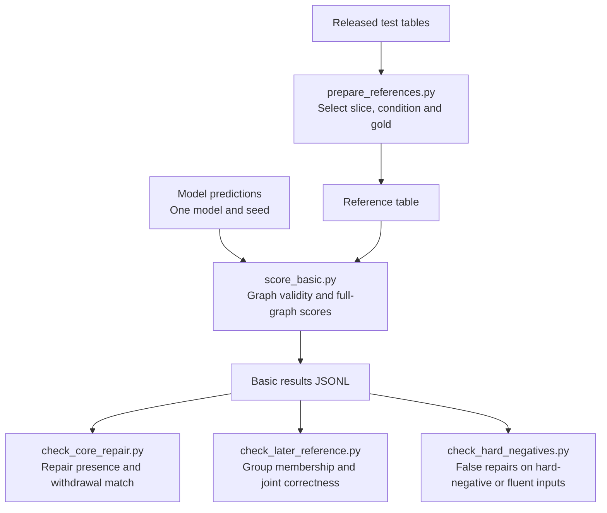

# Evaluation

The evaluation workflow checks how well model predictions recover the semantic
content and repair structure of the test inputs. Each run takes predictions
from one model and seed, together with gold references selected for the test
slice and parser condition.

`score_basic.py` checks graph validity and measures full-graph agreement with
SMATCH++. Its per-item results then feed the relevant targeted checker for
withdrawal matching, later reference or false repairs.



Each test slice uses the relevant checker; basic scores remain available for
all slices. The core and later-reference checkers also read the released gold
tables. Missing and invalid predictions remain in the results, although only
valid graphs undergo structural checks.

The scripts produce per-item scores and verdicts, together with basic
summaries. `score_batch.py` completes and verifies the imported 2B/9B/27B panel;
`analyse_batch.py` saves aggregate tables and selected document-paired
comparisons. [The formal results report](formal_results.qmd) reads these
saved tables and separates seed variation from within-seed bootstrap intervals.

## Test slices and references

The three parser conditions differ in their training targets. **C1 (ordinary
SBN baseline)** receives no replacement self-repair (RSR) supervision.
**C2 (normalising parser)** learns to recover ordinary SBN from RSR inputs,
while **C3 (repair-aware parser)** learns to retain the repair structure.

`prepare_references.py` selects the expected test items and their gold graphs
for one slice and condition.

| Test slice | Conditions | Gold column | Evaluation goal |
|---|---|---|---|
| `pmb_fluent` | C1, C2, C3 | `sbn_repair` | Ordinary semantic parsing and false repairs on fluent inputs. |
| `core_rsr` | C2, C3 | C2: `sbn_clean`; C3: `sbn_repair` | Normalised meaning for C2; full repair-aware graph agreement and withdrawal matching for C3. Includes paired unmarked and marked inputs. |
| `later_reference` | C2, C3 | Each partner’s own `sbn_repair` | Group-member recovery on fluent and RSR partners, with joint repair and reference checks for C3 RSR outputs. |
| `hard_negative` | C1, C2, C3 | `sbn_repair` | Content preservation and false repairs on non-repair constructions that resemble RSR. |

The gold column reflects the target representation. On core RSR, C2 is scored
against the normalised meaning and C3 against the complete repair-aware graph.
For fluent PMB and hard negatives, `sbn_repair` contains ordinary SBN without
repair structure.

Each later-reference partner has its own gold graph. Both conditions use these
graphs to identify the intended group members, including on the RSR side.
C2 is assessed for member recovery; C3 additionally undergoes repair and joint
correctness checks. Full-graph scores against the RSR gold measure agreement
with its complete repair-aware representation.

Selecting references before scoring makes these choices explicit and keeps
`score_basic.py` independent of the parser condition.

## Run evaluation

Run the commands from the repository root in the `repairsbn` environment.
The scorer uses the project’s SBN reader and SMATCH++ with an ILP backend.
Table input requires pandas and PyArrow; core withdrawal matching also
requires NetworkX. Set `SBN_SRC` if the reader is stored elsewhere on your
machine.

References and predictions accept TSV, CSV or Parquet with the following
columns.

| Input | Required columns |
|---|---|
| References | `example_id`, `condition`, `gold_sbn` |
| Predictions | `example_id`, `condition`, `pred_sbn` |

The pair `(example_id, condition)` identifies each result and must be unique
within each input table. Evaluate each model and seed separately.

### Audit test gold

Before scoring, audit all three test files, both core target columns and
comparison pairs. The audit uses the current reader's DAG constraint and
checks full-graph self-scores, repair structure and reference metadata.
It does not replace human review of sentence meaning.

```bash
python evaluation/audit_test_gold.py \
  --test-root repair_data_gen/training_dataset \
  --output evaluation/runs/gold-audit-20261115
```

Use a new output directory for each audit. `summary.json` records counts;
`items.jsonl` records every verdict. `exclude.tsv` and `hold.tsv` retain
reasons. Only passing rows enter `retained/`, with complete comparison pairs
and unchanged row values. Originals are preserved. The audit also writes
reference TSVs for every applicable slice and condition under `references/`.
Use the retained test root for reference selection and targeted gold checks.
Select prediction rows by the retained reference keys; preserve the original
prediction files and earlier scores.

### Prepare references

Select the slice and condition using `prepare_references.py`. For example,
to prepare the core RSR references for the repair-aware parser:

```bash
python evaluation/prepare_references.py \
  --test-root evaluation/runs/gold-audit-20261115/retained \
  --slice core_rsr --condition C3 --output core-c3-refs.tsv
```

The reference table contains all expected IDs for this selection. Keep it
complete so that missing predictions remain visible and do not silently
reduce the evaluation denominator.

### Select predictions

If the inference file contains several slices or conditions, select the
prediction rows whose `(example_id, condition)` keys occur in the reference
table. Preserve their condition labels and prediction strings, and save the
selection as `core-c3-preds.tsv`.

Missing prediction rows are allowed and will be recorded by the scorer.
Duplicate keys or prediction keys without matching references cause scoring
to stop.

### Run basic scoring

```bash
python evaluation/score_basic.py --references core-c3-refs.tsv \
  --predictions core-c3-preds.tsv --output core-c3-basic.jsonl
```

The output contains one JSON object per reference key.

| Fields | Meaning |
|---|---|
| `example_id`, `condition` | Identify the expected result. |
| `pred_status` | Records whether the prediction is valid, invalid, missing or affected by a reader error. |
| `score_status` | Records whether scoring completed, an incomplete prediction received the F1 penalty, or a gold/scorer error prevented scoring. |
| `precision`, `recall`, `f1` | Full-graph SMATCH++ scores from a single alignment. |
| `relation_matched`, `relation_total`, `relation_recall` | Matched and total gold relations, and their recall under the same alignment. |
| `pred_sbn`, `pred_reason`, `score_reason` | Retain the prediction and explain parsing or scoring failures. |

When the gold is valid, an invalid or missing prediction receives F1 zero.
Its precision, recall and relation metrics are null because no alignment was
run. Gold and scorer errors produce null metrics with an explanation.
A valid prediction can therefore have a scoring error, while a successfully
scored prediction can still express the wrong meaning.

Relation recall measures recovery of gold semantic and discourse relations,
excluding concept labels, box membership and the root triple. It is null when
the aligned gold contains no relations.

### Scope in full-graph scoring

`score_version: scoped_sbn_v2` retains each condition's role, source, target
and context. Bos (2023), [Appendix A](https://aclanthology.org/2023.iwcs-1.20.pdf),
places a concept's hooks and anchors in that concept's DRS; `CONJUNCTION`
adds conditions to its target DRS. The project's
[repair notation](../documentation/knowledge_base/repair_sbn_notation.qmd)
applies this mechanism to withdrawn and accepted material.

Role inversion normalises the endpoints but retains the condition's context.
For scoring, a condition becomes a node with a role label and three edges:
source, target and scope. Scope follows `CONJUNCTION` links to their target;
`CORRECTION` remains separate. Original boxes and concept membership are
retained, so F1 measures the complete encoded structure rather than logical
equivalence across arbitrary rewrites. Constants retain case.

This encoding changes F1's triple counts; old and new F1 values must not be
pooled. Relation recall still counts each original relation once, including
its scope and using the full alignment. Encoding edges are not separate
semantic relations. This is a project scoring encoding, not a new SBN rule.
The condition labels also separate the semantic role `Instance` from
SMATCH++'s reserved `:instance` declaration; the old lowercased encoding
confused these and omitted `Instance` from relation recall counts.

## Targeted checks

### Core RSR: repair presence and withdrawal matching

A repair-aware output should preserve the withdrawn content and the relations
that connect it to the sentence. For example, placing *tea* in the
`CORRECTION` box is insufficient if its role as the object of *ordered* is lost.

`check_core_repair.py` checks repair presence and compares the withdrawn
subgraph with gold for C3 core RSR outputs.

```bash
python evaluation/check_core_repair.py \
  --gold evaluation/runs/gold-audit-20261115/retained/data/test.parquet \
  --basic core-c3-basic.jsonl --output core-withdrawal.json
```

The report keeps three outcomes separate.

| Outcome | Meaning |
|---|---|
| `cc_present` | Whether a valid prediction contains a `CORRECTION-CONJUNCTION` configuration. |
| `withdrawal` | Whether the subgraph within the `CORRECTION` box and its boundary links match gold, including concepts, values, relations and scope. |
| `full_graph` | Full-graph scores retained from basic scoring. |

Withdrawal matching uses resolved graph structure, so renumbering SBN indices
does not change the verdict. It checks the withdrawn contribution and its
connections; correctness of the complete accepted contribution remains part
of full-graph scoring.

The summary reports withdrawal matching both among detected repairs and
across evaluable inputs. The end-to-end rate includes invalid and missing
predictions as incomplete. Cases requiring review are reported separately,
alongside gold coverage and review reasons.

To audit gold coverage without evaluating predictions, omit `--basic`.

### Later reference: membership and joint checks

Later-reference inputs test whether the parser links a group to both intended
antecedents. Each pair contains a fluent input and an RSR input. In the RSR
partner, recovering both members and preserving their repair status are
separate requirements. An output may link the group correctly while wrongly
treating the withdrawn contribution as accepted.

Prepare basic results with `--slice later_reference` and the chosen condition,
then run:

```bash
python evaluation/check_later_reference.py \
  --basic later-c3-basic.jsonl \
  --references later-c3-refs.tsv \
  --gold evaluation/runs/gold-audit-20261115/retained/later_reference/test.parquet \
  --output later-c3-checks.json
```

Both C2 and C3 undergo the same exact-membership check on both partners.
C3 RSR outputs additionally undergo repair and joint correctness checks.
An absent or incorrect required later-predicate connection is a failure;
ambiguous correspondences remain `review`. Per-member evidence remains null
when no unique group is identified. A definite component failure makes the
joint check fail even when the other component requires review.

| Outcome | Meaning |
|---|---|
| Exact membership | Whether the group’s `Sub` links recover exactly the intended members. |
| `member_recovered` | Recovery of each antecedent, listed in gold antecedent order. |
| `extra_members` | Number of unintended members, where correspondence can be resolved. |
| Repair correctness | Whether the required repair content, relations and scope are represented correctly in C3 RSR outputs. |
| Joint correctness | Whether the repair and group membership are both correct using the same referents. |

Repair presence is also recorded for valid predictions. A
`CORRECTION-CONJUNCTION` configuration is a false positive on fluent inputs;
its absence is a detection failure on C3 RSR inputs. C2 RSR outputs are
assessed for member recovery without requiring repair structure.

Membership and joint rates count invalid or missing predictions as incomplete.
Cases with unusable gold or ambiguous node matching are reported separately
as `review` and excluded from these rates. Repair-presence rates use valid
predictions. The report retains `pair_id` to link the fluent and RSR partners
for subsequent comparisons.

### Hard-negative and fluent false positives

Hard-negative inputs contain coordination, apposition or negation that may
resemble replacement repair. The parser should preserve their meaning without
introducing a `CORRECTION-CONJUNCTION` configuration. Fluent PMB inputs provide
a further check for false repairs in ordinary sentences.

Prepare basic results with `--slice hard_negative` and the chosen condition,
then run:

```bash
python evaluation/check_hard_negatives.py \
  --basic hard-negative-c3-basic.jsonl \
  --references hard-negative-c3-refs.tsv \
  --output hard-negative-c3-checks.json
```

The same checker accepts basic results for `pmb_fluent`. Keep the two slices’
reports separate. Both slices support C1, C2 and C3.
Both this checker and the later-reference checker require the complete
reference table and reject missing, extra or duplicate basic result keys.

The report records whether each valid prediction contains a
`CORRECTION-CONJUNCTION` configuration and summarises the false-positive count
and rate for each condition. Invalid and missing predictions receive no
false-positive judgement and are excluded from this rate.

Content preservation is assessed through full-graph F1 and relation recall in
the basic results. These scores capture omitted or altered meaning, while the
targeted checker identifies false repair configurations.

## Files and regression tests

The following files provide entry points for running and maintaining the
workflow.

| Role | Files |
|---|---|
| Reference selection | `prepare_references.py` |
| Test gold audit and retained panels | `audit_test_gold.py` |
| Graph validity and full-graph scoring | `score_basic.py`, `formal_graph.py` |
| Targeted checks | `check_core_repair.py`, `check_later_reference.py`, `check_hard_negatives.py` |
| Local matching and gold requirements | `formal_local.py`, `formal_gold.py` |
| Reader location and table input | `sbn_env.py`, `tables.py` |
| Regression tests | `tests/` |

Run the regression tests from the repository root:

```bash
python -m unittest discover -s evaluation/tests
```

## Legacy

`score_formal.py` is the earlier combined prototype and remains in use by the
original acceptance tests. Use the modular workflow above for current
evaluation.

The [archived Metrics A/B scripts and tests](../archive/evaluation_metric_ab/README.md)
document the earlier scoring and pruning workflow. Pruning is outside the
current evaluation pipeline.
